# Modelo de datos del ciclo de compra

Entregable de **CCPIP-19**. Alcance: lo que el primer MVP necesita para que un comprador
entre, encuentre un producto, lo compre y lo recoja en un punto de acopio.

Trece tablas. Probado contra PostgreSQL 17, la version de docker-compose: las cinco migraciones corren de cero sobre
una base vacia, las semillas se pueden volver a ejecutar sin duplicar, y las nueve
restricciones de los requisitos no funcionales bloquean lo que deben bloquear.

## Diagrama entidad relacion

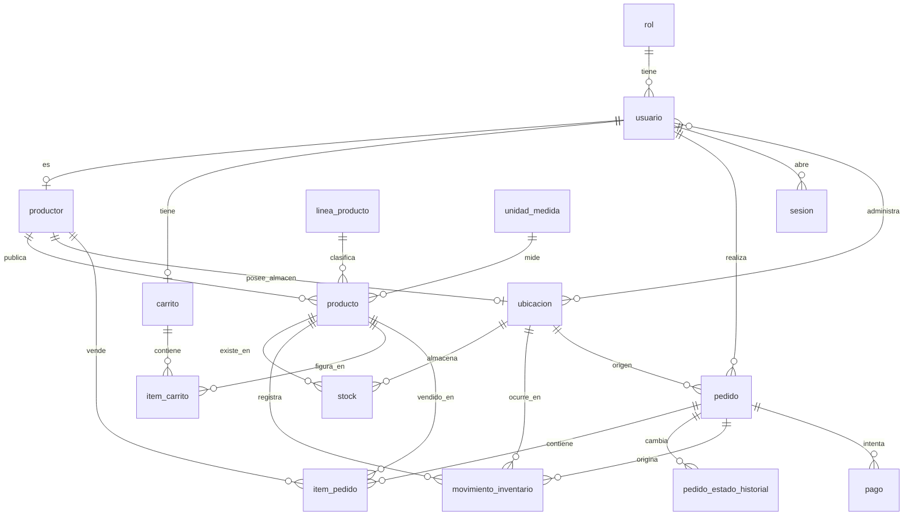

La relacion central es **productor, producto y stock por ubicacion**. El lote entra en
Sprint 1 con CCPIP-41 y se cuelga de producto sin tocar pedido ni carrito, que es uno
de los criterios de aceptacion de esta historia.

## Diccionario de datos

### rol
Catalogo cerrado de los seis roles. No se crea ni se edita desde la aplicacion en
Sprint 0, eso es CCPIP-28.

| Columna | Tipo | Nulo | Nota |
|---|---|---|---|
| id | smallint | no | Llave primaria, valor fijo del 1 al 6 |
| codigo | varchar(40) | no | Unico. CONSUMIDOR, PRODUCTOR, ADMIN_PUNTO, SUB_ADMIN, SUPER_ADMIN, DISTRIBUIDOR |
| nombre | varchar(80) | no | Nombre para mostrar |

### usuario
| Columna | Tipo | Nulo | Nota |
|---|---|---|---|
| id | bigserial | no | |
| correo | varchar(255) | no | Unico, e indexado en minusculas. RNF-40 |
| contrasena_hash | varchar(255) | no | Solo el hash BCrypt. RNF-01 |
| nombre | varchar(160) | no | |
| rol_id | smallint | no | Referencia a rol |
| activo | boolean | no | Una cuenta se desactiva, no se borra. RNF-18 |
| intentos_fallidos | smallint | no | Contador para el bloqueo temporal |
| bloqueado_hasta | timestamptz | si | Nulo significa no bloqueado. RNF-02 |
| idioma | varchar(2) | no | `es` o `en`, por defecto `es`. Preferencia de idioma de la cuenta, CCPIP-265. El visitante la guarda solo en su navegador |
| telefono | varchar(20) | si | Celular opcional que se da al registrarse. CCPIP-26 |
| estado | varchar(20) | no | `ACTIVA`, `SUSPENDIDA` o `DESACTIVADA`. Restriccion: `activo = (estado = 'ACTIVA')`. CCPIP-303, 306, 307 |

### sesion
Sesion con token opaco aleatorio, entregado en cookie HttpOnly y guardado en el servidor.
Cerrar sesion borra la fila, y eso invalida el acceso de inmediato como exige RNF-03
(CCPIP-266). La sesion expira tras un plazo sin actividad configurable,
`ccpip.auth.session-timeout` (variable `CCPIP_AUTH_SESSION_TIMEOUT`; 30 minutos por defecto, 2
en el stack de e2e). El carrito vive en `carrito` e `item_carrito`, ligado al usuario y no a la
sesion: expirar o cerrar sesion no lo borra, y al volver a ingresar sigue igual (CCPIP-267).
Reemplaza a la tabla token_revocado que venia de usar JWT: con JWT habia que consultar
la lista de revocados en cada peticion de todos modos, y la expiracion por inactividad
obligaba a reemitir tokens. ADR-05 se actualiza a token opaco.

| Columna | Tipo | Nulo | Nota |
|---|---|---|---|
| token_hash | char(64) | no | SHA-256 del token, llave primaria. El token en claro nunca se guarda |
| usuario_id | bigint | no | Indexado, para cerrar todas las sesiones al bloquear a un usuario |
| creado_en | timestamptz | no | |
| ultimo_acceso | timestamptz | no | Indexado. Base de la expiracion por inactividad y de la purga |

### linea_producto, unidad_medida
Catalogos cerrados. RNF-32: el productor no crea unidades de medida, las solicita al
administrador, que es CCPIP-119 y CCPIP-137 en Sprint 1. Las lineas las administra el
superadministrador desde el catalogo maestro (ver "Catalogo maestro" mas abajo).

### productor
| Columna | Tipo | Nulo | Nota |
|---|---|---|---|
| id | bigserial | no | |
| usuario_id | bigint | no | Unico. Un usuario de rol PRODUCTOR es un productor |
| comunidad | varchar(160) | no | Nombre de la comunidad productora |
| region | varchar(80) | no | Indexado, para el filtro de CCPIP-165 |
| historia | text | si | Historia de la comunidad, distinta de la del producto |
| origen_verificado | boolean | no | CCPIP-38. Entra sembrado, no hay flujo de postulacion |
| activo | boolean | no | |

### producto
| Columna | Tipo | Nulo | Nota |
|---|---|---|---|
| id | bigserial | no | |
| productor_id | bigint | no | |
| nombre | varchar(200) | no | Indexado con lower(inmutable_unaccent(nombre)) para RNF-22 |
| descripcion | text | si | |
| historia_origen | text | si | CCPIP-152. El diferenciador de la plataforma |
| linea_id | smallint | no | |
| unidad_medida_id | smallint | no | |
| precio | numeric(10,2) | no | Mayor que cero. En soles, RNF-43 |
| es_materia_prima | boolean | no | Producto terminado o materia prima |
| estado | varchar(20) | no | BORRADOR, PUBLICADO o RETIRADO. RNF-17 |

### ubicacion
Una sola tabla para punto de acopio y almacen de productor, porque ambos siguen las
mismas reglas de movimiento y merma, que es lo que pide CCPIP-136. Separarlos en dos
tablas obligaria a duplicar stock y movimiento_inventario.

| Columna | Tipo | Nulo | Nota |
|---|---|---|---|
| id | bigserial | no | |
| tipo | varchar(20) | no | PUNTO_ACOPIO o ALMACEN_PRODUCTOR |
| nombre | varchar(160) | no | Unico entre los puntos de acopio |
| productor_id | bigint | si | Obligatorio si es almacen, prohibido si es punto de acopio |
| departamento, provincia, distrito | varchar | depto no | Division politica. Sin coordenadas: RNF-31 |

### usuario_ubicacion
Que punto administra cada usuario. Es lo que sostiene el aislamiento de RNF-05, que se
aplica filtrando en la consulta al servidor y no ocultando datos en la pantalla.

### stock
**Es una tabla, no una vista.** Se actualiza en la misma transaccion que cada
movimiento. Decidido en ADR-10 y es la decision mas facil de malinterpretar de todo el
modelo: si fuera una vista que suma movimientos, se perderia la restriccion de cantidad
no negativa y cada lectura del catalogo seria una agregacion.

| Columna | Tipo | Nulo | Nota |
|---|---|---|---|
| producto_id, ubicacion_id | bigint | no | Llave primaria compuesta |
| cantidad | numeric(12,3) | no | CHECK cantidad >= 0. RNF-09 |

El **stock virtual unico** que ve el consumidor es la suma de las filas de un producto
en todas sus ubicaciones. No se guarda en ninguna parte, se calcula al consultar:

```sql
SELECT sum(cantidad) FROM stock WHERE producto_id = :id;
```

### movimiento_inventario
Tabla de solo insercion. Dos disparadores impiden UPDATE y DELETE, porque una regla que
solo vive en el codigo de la aplicacion se salta desde cualquier cliente SQL. RNF-15 y
RNF-16: una correccion se hace con un movimiento de tipo AJUSTE que conserva el original.

| Columna | Tipo | Nulo | Nota |
|---|---|---|---|
| id | bigserial | no | |
| producto_id, ubicacion_id | bigint | no | |
| tipo | varchar(20) | no | ENTRADA, SALIDA, SALIDA_VENTA, TRANSFERENCIA_ENTRADA, TRANSFERENCIA_SALIDA, AJUSTE |
| cantidad | numeric(12,3) | no | Siempre positiva. El signo lo da el tipo |
| pedido_id | bigint | si | Cuando el movimiento viene de una venta |
| usuario_id | bigint | si | Quien lo registro |

### carrito, item_carrito
El carrito se persiste en base de datos, no en el navegador. Era el punto abierto numero
uno del informe de arquitectura: el modulo lo mencionaba y el modelo no lo tenia.

RNF-35: estar en el carrito **no reserva ni descuenta** stock. Un producto aparece una
sola vez por carrito, agregarlo de nuevo suma cantidad.

**Vigencia (CCPIP-142, RF-109, RNF-36).** Migracion `V202610171600__vigencia_carrito.sql`. El
carrito se conserva durante la vigencia de `parametro_plataforma` (ver mas abajo), contada desde
`actualizado_en`, que cambia al agregar, modificar o quitar; consultar no la renueva. No depende de
la sesion: cerrar sesion o que expire no lo borra, y una sesion activa no mantiene vivo un carrito
vencido. Vencido, se vacia (se borran sus `item_carrito`) al consultarlo o cambiarlo, o en el barrido
programado cada 15 minutos, y se anota `vencido_en` para avisarle al comprador. No hay movimiento de
inventario porque nunca reservo. Agregar de nuevo limpia `vencido_en`.

| Columna | Tipo | Nulo | Nota |
|---|---|---|---|
| actualizado_en | timestamptz | no | Ultimo cambio del comprador: base de la vigencia. Indice para el barrido |
| vencido_en | timestamptz | si | Cuando se vacio por vencer. Nulo si no vencio o si ya se volvio a agregar |

**Agrupado por productor (CCPIP-63, RF-44).** No cambia el modelo: la respuesta del carrito agrupa
las ofertas por `producto.productor_id` (su tienda o comunidad) con el subtotal de lo comprable, y el
total es la suma exacta de esos subtotales.

### parametro_plataforma
Historial de los parametros de SA-02 "Parametros de la plataforma" que fija el superadministrador.
Rige la ultima fila de cada clave. Por ahora una sola clave, `CARRITO_VIGENCIA_HORAS`; las resenas
minimas y la anticipacion de alertas entran con sus historias.

| Columna | Tipo | Nulo | Nota |
|---|---|---|---|
| clave | varchar(40) | no | `CARRITO_VIGENCIA_HORAS` |
| valor | integer | no | Mayor que cero. La API acepta de 1 a 720 horas |
| registrado_por, registrado_en | | no | Quien y cuando |

Es la auditoria del cambio: un trigger impide editarla y borrarla. La migracion no siembra ningun
valor porque la Camara no lo ha definido ("Pendiente de definicion del stakeholder" en el Figma).
Sin filas rige `ccpip.carrito.vigencia-provisional` (2 h, el valor de ejemplo del Figma SA-02),
documentado como **provisional** en `application.properties`.

### pedido, item_pedido, pedido_estado_historial
| Columna | Tipo | Nulo | Nota |
|---|---|---|---|
| numero | varchar(20) | no | Unico, el que ve el comprador |
| modalidad | varchar(20) | no | RECOJO o ENVIO. En Sprint 0 solo RECOJO |
| ubicacion_origen_id | bigint | no | Punto donde recoge o desde donde se despacha |
| estado | varchar(30) | no | CONFIRMADO, EN_PREPARACION, LISTO_PARA_RECOJO, ENTREGADO, CANCELADO |
| total | numeric(12,2) | no | En soles. Sin columna de divisa, RNF-43 |

**item_pedido.precio_unitario es copia del precio al confirmar.** RNF-13: un cambio
posterior en producto.precio no altera un pedido ya confirmado. Para mostrar un pedido
pasado nunca se lee el precio vigente.

**item_pedido.productor_id tambien se copia**, para que el aislamiento de RNF-05 no
dependa de seguir la cadena hasta producto, que puede haber cambiado de estado.

## Como se cumple RNF-10, que es el requisito mas delicado

"El descuento de existencias al confirmar un pedido resiste pedidos simultaneos sin
duplicar ni perder unidades."

No se resuelve con bloqueos ni con reintentos. Se resuelve con un UPDATE condicionado,
que es atomico en PostgreSQL:

```sql
UPDATE stock
   SET cantidad = cantidad - :pedida
 WHERE producto_id = :producto
   AND ubicacion_id = :ubicacion
   AND cantidad >= :pedida;
```

Si devuelve cero filas afectadas, no habia suficiente y el pedido se rechaza. Dos
pedidos simultaneos no pueden llevarse la misma unidad porque el segundo encuentra la
cantidad ya decrementada. Probado: con 3 unidades, un pedido de 2 pasa y el siguiente de
2 se rechaza, quedando 1 y nunca un negativo.

El movimiento de inventario se escribe **en la misma transaccion** que ese UPDATE. Si se
escriben por separado, un fallo entre ambos deja el stock sin explicacion.

## Tienda, publicacion, lotes e imagenes (Sprint 1)

Migraciones `V202610041200` a `V202610041204`. Agregan lo que necesita el flujo del prototipo:
la comunidad arma su tienda, publica productos con fotos e historia, registra lotes, y el
comprador ve solo lo que de verdad se puede vender.

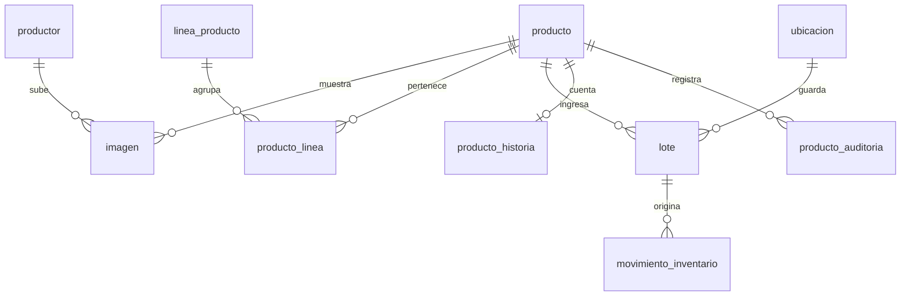

### productor (columnas de tienda, CCPIP-30, 56, 153, 154)
La tienda vive en la fila del productor: hay exactamente una por productor. `nombre_tienda`,
`descripcion_corta`, `cita`, `pueblo`, `localidad`, `socios`, `verificado_en`,
`tienda_publicada` y `tienda_publicada_en`. Una tienda publicada siempre tiene nombre (CHECK).
Solo las tiendas publicadas aparecen en `/api/tiendas` y sus productos en el catalogo.

### producto (columnas nuevas, CCPIP-40, 45, 47, 132, 143)
Un producto nace como borrador desde PW-04, por eso `linea_id`, `unidad_medida_id` y `precio`
pasan a aceptar nulos; publicar los exige (servidor). Nuevas: `contenido` ("250 ml"),
`modalidad` (MINORISTA, MAYORISTA, AMBAS), `precio_mayorista` (menor que el minorista, CHECK),
`cantidad_minima_mayorista` (2 o mas), `destacado_tienda`, `descripcion_propuesta` y
`descripcion_asistida` (IA, RNF-29), `publicado_en`, `creado_por` y `actualizado_por`.
No hay columna de descuento (CCPIP-87) ni forma de borrar un producto (RNF-17): se despublica.

### producto_linea (CCPIP-45)
Un producto puede estar en varias lineas. `producto.linea_id` queda como la principal, la que
muestra la tarjeta. `linea_producto` gana `requiere_vencimiento` (una artesania no vence),
`unidad_sugerida_id` y `orden`.

### lote (CCPIP-41)
| Columna | Tipo | Nulo | Nota |
|---|---|---|---|
| producto_id, ubicacion_id | bigint | no | Ubicacion: almacen del productor o punto de acopio |
| codigo | varchar(40) | no | Unico por producto. Interno: nunca se muestra al comprador |
| cantidad_inicial, cantidad_actual | numeric(12,3) | no | 0 ≤ actual ≤ inicial (RNF-09) |
| fecha_produccion, fecha_vencimiento | date | si | Vencimiento posterior a la produccion; no anterior a hoy (servidor) |

Registrar un lote escribe el lote, su movimiento `ENTRADA` (`movimiento_inventario.lote_id`) y
suma al `stock` en una sola transaccion (ADR-10). **Lo que el comprador ve como disponible es
la suma de los lotes no vencidos en puntos de acopio**; lo que esta en el almacen del productor
se vende recien cuando se transfiera.

### imagen (CCPIP-30, 44)
Referencia a un objeto del bucket S3 (`clave` y `clave_miniatura`), con `tipo` PORTADA,
GALERIA o PRODUCTO, `categoria` de galeria, dimensiones y `principal`. Una sola portada por
tienda y una sola principal por producto (indices unicos parciales). Se sirve por
`/api/imagenes/{id}`, nunca con la URL del bucket, que es privado.

Las fotos de producto no se borran (CCPIP-388, 389): `retirada_en` y `retirada_por` las sacan
de la ficha y del editor, pero el registro y el archivo quedan y se siguen sirviendo por su id.
Al reemplazar una, `reemplazada_por` apunta a la nueva, que toma su orden y su `principal`.
Solo las vigentes cuentan para el limite de seis fotos. Portada y galeria se siguen borrando.

### imagen_validacion (CCPIP-144, 168)
Migracion `V202610171300`. Cada vez que el productor pide validar una foto de producto queda
una fila: `estado` (ANALIZANDO, VALIDA, SOSPECHOSA, ERROR), `linea_esperada` (la principal del
producto), `linea_detectada` (la que coincide o a la que se parece), `motivo`, `proveedor`,
`solicitada_por`, `solicitada_en` y `terminada_en` (nula solo mientras se analiza). La vigente
es la ultima; las anteriores, incluidas las que fallaron, quedan como historial. Es solo una
recomendacion: no bloquea la publicacion ni cambia la foto (RF-137). Hoy el proveedor es
`simulado` (pruebas y demo) o `ninguno` (503); el modelo definitivo se conectara despues.

### imagen_mejora (CCPIP-176, 272, 281, 282)
Migracion `V202610171301`. La variante mejorada de una foto vive aparte, con su propia `clave`
y `clave_miniatura` en el bucket (`productores/<id>/mejoras/<mejora>.jpg`), y se sirve solo a
su dueno por `/api/productor/mejoras/{id}`. `estado` PENDIENTE, ACEPTADA o RECHAZADA, con
`ajustes` (p. ej. AUTOCONTRASTE,NITIDEZ), `proveedor`, quien y cuando la pidio y la decidio.
Una sola pendiente por foto (indice unico parcial). Al aceptarla se registra una `imagen` nueva
con la clave de la variante que toma el lugar de la original, igual que un reemplazo: la
original queda retirada y `reemplazada_por` apunta a la nueva; `imagen_resultante` la enlaza.
Rechazarla no toca la original.

### producto_historia (CCPIP-48, 49)
Las cuatro respuestas del productor (`quienes`, `como`, `significado`, `cuidado`), el texto
que propuso la IA (`texto_propuesto`) y el aprobado (`texto_final`), con `asistida`,
`proveedor_ia`, `aprobada_en` y `aprobada_por`. La ficha solo muestra historias aprobadas.

### producto_auditoria (CCPIP-47)
Quien cambio que y cuando: `accion` (CREAR, EDITAR, PUBLICAR, RETIRAR, REPUBLICAR, HISTORIA,
LOTE, IMAGEN, y desde `V202610171200` EVIDENCIA y AUTORIZACION) y `cambios` en jsonb con el antes y el despues. Solo insercion: un trigger
rechaza UPDATE y DELETE, igual que en `movimiento_inventario`.

## Cuenta bancaria y autorizacion para vender (CCPIP-269)

Migracion `V202610121000`. RF-142: solo se compra lo autorizado a un productor con cuenta
bancaria activa. Entra solo lo que esa regla necesita; el registro de la cuenta (CCPIP-32) y el
flujo de autorizacion con evidencias (CCPIP-359) agregan lo suyo con sus historias.

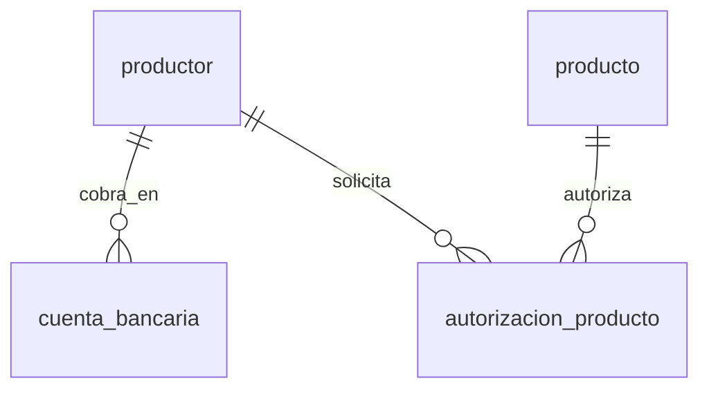

### cuenta_bancaria
`productor_id`, `banco`, `titular`, `numero_cuenta`, `cci` y `estado` (ACTIVA, DESACTIVADA).
Como maximo una ACTIVA por productor (indice unico parcial); las desactivadas se conservan.
No vence (CCPIP-129).

Migracion `V202610161500` (CCPIP-32, 274, 275 y 276, Figma PW-19 y PW-20) agrega lo que el
productor registra y como se desactiva:

| Columna | Tipo | Nula | Descripcion |
|---|---|---|---|
| documento_titular | varchar(11) | si | DNI (8) o RUC (11). Nula solo en cuentas anteriores a CCPIP-32 |
| tipo_cuenta | varchar(10) | no | `AHORROS` o `CORRIENTE` |
| moneda | char(3) | no | `PEN` o `USD` |
| correo_avisos | varchar(254) | si | Correo para avisos de pago, opcional |
| yape_celular | varchar(9) | si | Metodo complementario opcional; no reemplaza la cuenta (RF-07) |
| motivo_desactivacion | varchar(20) | si | `ROBO`, `BLOQUEO_BANCO`, `SEGURIDAD` u `OTRO`; solo si esta DESACTIVADA |
| desactivada_en | timestamptz | si | Desde cuando esta desactivada |

El banco sale de una lista cerrada y el CCI se guarda con sus 20 digitos, sin guiones. Desactivar
pide un motivo y confirmacion expresa; reactivar vuelve a validar los datos y pide la contrasena.
Mientras esta DESACTIVADA, las ofertas del productor siguen visibles en "Venta pausada" y los
pedidos ya pagados siguen su curso (supuesto de PW-20, por validar con el stakeholder).

### autorizacion_producto
`productor_id`, `producto_id`, `estado` (SOLICITADA, APROBADA, RECHAZADA, REVOCADA), `motivo`,
`decidido_por`, `decidido_en` y `vigente_hasta` (nula si no vence). Unica por productor y
producto. El diccionario la liga a `producto_maestro`; la tabla ya existe (V202610171900), pero la
autorizacion sigue apuntando a `producto` hasta que una historia migre el vinculo. La migracion deja APROBADA lo que ya se vendia.

**Una oferta es comprable** si su productor tiene una cuenta ACTIVA y una autorizacion APROBADA
para ese producto con `vigente_hasta` nula o de hoy en adelante (hora de Lima). Si no, sigue
visible en el catalogo, pero en "Venta pausada": la ficha lo dice con `comprable: false` y el
carrito marca el item `VENTA_PAUSADA` sin sumarlo al total.

**La autorizacion es por producto y por productor** (CCPIP-270, RF-143). Elegir una linea no
autoriza todos sus productos, y la autorizacion de otro productor para el mismo producto no
vale. El servidor lo controla en cada paso donde se puede comprar:

| Momento | Si la oferta no esta autorizada |
|---|---|
| Agregar o cambiar la cantidad en el carrito | `409 VENTA_PAUSADA` |
| Consultar el carrito | El item queda `VENTA_PAUSADA` y no suma al total |
| Confirmar la compra (`POST /api/pedidos`) | `409 CARRITO_CON_PROBLEMAS` |
| Pagar (`POST /api/pedidos/{id}/pagos`), por si se revoco despues de crear el pedido | No se cobra, el pedido se cancela y responde `409 VENTA_PAUSADA` |

## Evidencias y revision de autorizaciones (CCPIP-36, CCPIP-50, CCPIP-174, CCPIP-284)

Migraciones `V202610171200` (evidencias y decisiones) y `V202610171201` (analisis preliminar).
El productor adjunta certificados, documentos y evidencias a cada producto (RF-13, Figma PW-14);
el subadministrador los revisa en la bandeja (S-01) y el expediente (S-02), puede pedir un
analisis preliminar asistido (RF-74) y aprueba o rechaza con motivo (RF-166, RF-204).

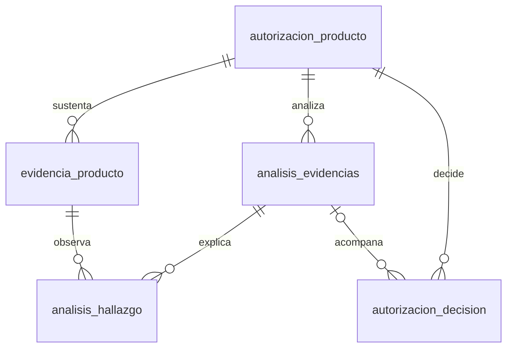

**Integracion con la regla de compra.** No hay un segundo estado: la solicitud ES la fila de
`autorizacion_producto`. Subir la primera evidencia la crea en `SOLICITADA`. Aprobar la deja
`APROBADA`, con `vigente_hasta` igual al certificado vigente que vence primero y `decision_id`
apuntando a la decision. Asi la regla de CCPIP-269/270 (APROBADA y vigente) habilita la compra
sin cambios, y cuando el certificado vence la oferta vuelve sola a "Venta pausada". Lo aprobado
por la migracion `V202610121000` y por las semillas queda con `decision_id` nula.

| Estado actual | Evidencia nueva del productor | Retirar evidencia |
|---|---|---|
| sin fila | crea la solicitud en SOLICITADA | no aplica |
| SOLICITADA | se agrega | se retira (logico) |
| RECHAZADA, REVOCADA o APROBADA vencida | vuelve a SOLICITADA y limpia motivo y decision | se retira |
| APROBADA vigente | `409 AUTORIZACION_VIGENTE` | `409 EVIDENCIA_EN_USO` |

### autorizacion_producto (columnas nuevas)
| Columna | Tipo | Nula | Descripcion |
|---|---|---|---|
| solicitada_en | timestamptz | si | Cuando entro (o volvio) a SOLICITADA. Ordena la bandeja |
| decision_id | bigint | si | La decision que fijo el estado actual. Nula en lo aprobado antes de la bandeja |

Se agrega el unico `(id, productor_id, producto_id)` para la llave compuesta de las evidencias.

### evidencia_producto
| Columna | Tipo | Nula | Descripcion |
|---|---|---|---|
| id | uuid | no | Identificador; el archivo se sirve solo con sesion (RNF-08) |
| autorizacion_id, productor_id, producto_id | bigint | no | Llave foranea compuesta a `autorizacion_producto`: un certificado de otro producto no puede sustentar el solicitado |
| tipo | varchar(12) | no | `CERTIFICADO`, `DOCUMENTO` o `EVIDENCIA` |
| titulo, emisor | varchar(160) | emisor si | Nombre del documento y quien lo emite |
| vigente_desde, vigente_hasta | date | si | Vigencia en hora de Lima. `vigente_hasta` es obligatoria en certificados |
| nombre_archivo, content_type, bytes, clave | | no | PDF, JPG o PNG reconocido por sus primeros bytes, hasta 10 MB; vive en el bucket bajo `evidencias/` |
| subida_en, subida_por | | no | Quien la subio |
| retirada_en, retirada_por | | si | Retiro logico: se conserva porque las decisiones la citan |

Hasta 10 evidencias vigentes por producto.

**Lo publico (CCPIP-365, RF-255).** `GET /api/productos/{id}/certificacion`, sin sesion y solo de
ofertas visibles del catalogo, publica de cada evidencia `tipo`, `titulo`, `emisor` y vigencia, nunca el
archivo. Solo las que cita la decision APROBADA vigente (`autorizacion_decision.evidencias`), sin
retirar, y solo `CERTIFICADO` y `EVIDENCIA`: un `DOCUMENTO` puede ser privado. El estado es
`VERIFICADA` solo con la autorizacion aprobada y vigente y un certificado publico vigente; `VENCIDA`
si sus certificados vencieron; `SIN_EVIDENCIA` en cualquier otro caso (incluido lo aprobado por la
semilla, que no tiene evidencias), para no afirmar una aprobacion sin evidencia.

### autorizacion_decision
`decision` (APROBADA, RECHAZADA), `motivo` obligatorio (hasta 500), `evidencias` (uuid[] de las
vigentes al decidir; al aprobar no puede ir vacio), `vigente_hasta`, `analisis_id` (nulo si se
reviso a mano), `decidido_por` y `decidido_en`. Solo insercion por trigger (`solo_insercion()`).
Aprobar exige al menos un certificado vigente propio (`409 SIN_CERTIFICADO_VIGENTE`); una
solicitud que no esta SOLICITADA no se decide (`409 SOLICITUD_YA_RESUELTA`). Cada decision y cada
evidencia subida o retirada tambien queda en `producto_auditoria` (`AUTORIZACION`, `EVIDENCIA`).

### analisis_evidencias, analisis_hallazgo
El analisis es una sugerencia y nunca cambia el estado (RNF-30). `estado` COMPLETADO o
NO_DISPONIBLE, `proveedor`, `simulado`, `recomendacion` (SIN_OBSERVACIONES, REVISAR), `resumen`
y `evidencias` analizadas. Cada hallazgo (FALTANTE, INCONSISTENCIA, CONFORME) apunta a la
evidencia que lo origina (RNF-48). Ambas tablas son de solo insercion.

El proveedor se elige con `ccpip.ia.proveedor`, igual que la redaccion asistida. El definitivo
aun no esta elegido: `ninguno` (por defecto) responde `503 IA_NO_DISPONIBLE`, queda registrado
como NO_DISPONIBLE y la solicitud se decide a mano; `simulado` aplica reglas fijas sobre lo
declarado (sin leer el archivo) y se marca `simulado = true` en la base y en la pantalla como
resultado de prueba. Solo se usa en pruebas y demo.

## Revocacion, lineas autorizadas y tienda habilitada (CCPIP-39, CCPIP-330, CCPIP-291, CCPIP-292)

Migracion `V202610172600`. El subadministrador revoca con motivo la venta de un producto (RF-16)
o de un productor completo (RF-220), habilita la tienda de un productor autorizado (RF-147) y ve,
productor por productor, los productos que cada uno puede vender (RF-148). Toda decision se avisa
al productor por correo, en su idioma (`usuario.idioma`), y queda visible en sus pantallas; tambien
la aprobacion y el rechazo (CCPIP-37, CCPIP-297). Cada envio queda en `aviso` (tipos nuevos
`DECISION_AUTORIZACION`, con referencia a `autorizacion_decision`, y `DECISION_PRODUCTOR`, a
`productor_decision`). Si el correo falla, el aviso queda FALLIDO y la decision no se deshace.

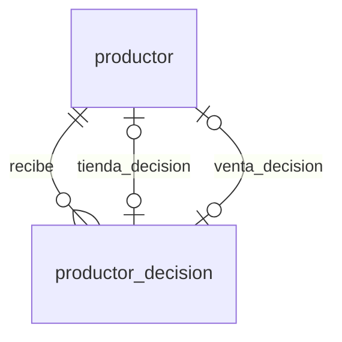

**Una oferta es comprable** ahora, ademas de lo de CCPIP-269, solo si la venta de su productor no
esta revocada y si todas las lineas actuales del producto estan en `autorizacion_producto.lineas`.
La regla vive en un solo lugar (`CatalogoRepository.HABILITADA`), asi que el catalogo, el carrito,
la confirmacion y el pago la aplican al instante. Los pedidos confirmados no se tocan.

| Decision | Quien | Exige | Efecto |
|---|---|---|---|
| Revocar producto (`POST /api/admin/autorizaciones/{id}/revocar`) | SUB_ADMIN | APROBADA (vigente o vencida), si no `409 AUTORIZACION_NO_APROBADA` | `autorizacion_producto` pasa a REVOCADA; fila REVOCADA en `autorizacion_decision`. El productor puede volver a solicitarla con evidencias nuevas |
| Revocar productor (`POST /api/admin/productores/{id}/revocar`) | SUB_ADMIN | no revocado, si no `409 VENTA_YA_REVOCADA` | `productor.venta_revocada`; sus autorizaciones por producto no cambian y quedan citadas como alcance |
| Restituir productor (`.../restituir`) | SUB_ADMIN | revocado, si no `409 VENTA_NO_REVOCADA` | Vuelve a vender lo que tenia autorizado |
| Habilitar tienda (`.../habilitar-tienda`) | SUB_ADMIN | no habilitada y venta no revocada (`409 TIENDA_YA_HABILITADA`, `VENTA_REVOCADA`). Productor autorizado = incorporado por la Camara (no hay postulacion), activo y sin revocar | `productor.tienda_habilitada`; recien entonces el productor puede publicarla (`409 TIENDA_NO_HABILITADA`). Cada producto sigue necesitando su propia autorizacion |

Un certificado vencido pausa la venta pero no es una revocacion (C5): el estado sigue APROBADA y
no se registra decision.

### renovacion_certificado (CCPIP-321)
Migracion `V202610211800`. El subadministrador pide renovar un certificado de una autorizacion
APROBADA (`POST /api/admin/autorizaciones/{id}/renovaciones`, `409 AUTORIZACION_NO_APROBADA`). Llega al
productor por correo (aviso `RENOVACION_CERTIFICADO`) y en las evidencias de su producto (PW-14).
**No cambia la autorizacion ni la venta:** no hay decision ni cambio de estado. Si el certificado vence
sin renovarse rige C5 (Venta pausada, sin revocar), y nunca hay un bloqueo permanente automatico.

| Columna | Tipo | Nulo | Nota |
|---|---|---|---|
| autorizacion_id, productor_id, producto_id | bigint | no | Llave compuesta a `autorizacion_producto` |
| evidencia_id | uuid | no | El certificado (`CERTIFICADO` sin retirar de esa autorizacion, si no `422 CERTIFICADO_INVALIDO`) |
| motivo | varchar(500) | no | Obligatorio |
| plazo | date | no | Por defecto el vencimiento del certificado, u hoy si ya vencio. No pasado (`422 PLAZO_PASADO`) |
| estado | varchar(10) | no | `PENDIENTE`; `ATENDIDA` y `CANCELADA` llegan con sus historias. Una pendiente por certificado (`409 RENOVACION_PENDIENTE`) |
| solicitada_por, solicitada_en | | no | Quien y cuando. Tambien queda en `producto_auditoria` (`AUTORIZACION`) |
| atendida_en | timestamptz | si | Obligatoria fuera de `PENDIENTE` |

Un trigger impide borrarla y editarla, salvo pasar una vez de `PENDIENTE` a otro estado.

### autorizacion_producto (columna nueva)
| Columna | Tipo | Nula | Descripcion |
|---|---|---|---|
| lineas | smallint[] | si | Lineas del producto al aprobarse. Obligatoria si el estado es APROBADA; la fija el trigger `autorizacion_fija_lineas()` al pasar a APROBADA. Si el producto suma otra linea, la oferta queda en Venta pausada y el productor puede pedir otra revision |

### autorizacion_decision
`decision` admite ahora tambien REVOCADA.

### productor_decision
| Columna | Tipo | Nula | Descripcion |
|---|---|---|---|
| id | bigserial | no | |
| productor_id | bigint | no | |
| decision | varchar(16) | no | `HABILITAR_TIENDA`, `REVOCAR_VENTA` o `RESTITUIR_VENTA` |
| motivo | varchar(500) | no | Obligatorio |
| autorizaciones | bigint[] | no | Autorizaciones APROBADAS y vigentes al decidir: el alcance |
| decidido_por, decidido_en | | no | Quien y cuando |

Solo insercion por trigger. Revocar o restituir tambien deja una fila `AUTORIZACION` en
`producto_auditoria` de cada producto alcanzado.

### productor (columnas nuevas)
| Columna | Tipo | Nula | Descripcion |
|---|---|---|---|
| tienda_habilitada | boolean | no | La Camara habilito la tienda. `CHECK (NOT tienda_publicada OR tienda_habilitada)` |
| tienda_decision_id | bigint | si | Decision que la habilito. Nula en los datos iniciales |
| venta_revocada | boolean | no | La venta del productor esta revocada |
| venta_decision_id | bigint | si | Ultima revocacion o restitucion |

**Datos iniciales (habilitacion manual documentada de RF-147).** La migracion habilita las tiendas
que ya estaban publicadas, y la semilla `R__02` habilita las de los tres productores de
demostracion. `productor_nuevo@ccpip.test` queda sin habilitar para probar el flujo completo.

## Catalogo maestro y ofertas por productor (CCPIP-42)

Migracion `V202610171900`. RF-18: el visitante consulta las ofertas de distintos productores
para un mismo producto del catalogo maestro. La fila de `producto` pasa a ser **la oferta** de
un productor; el maestro es el producto generico que define la Camara.

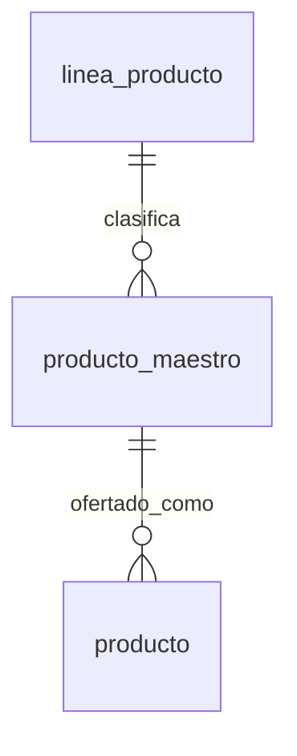

### producto_maestro
| Columna | Tipo | Nulo | Nota |
|---|---|---|---|
| id | bigserial | no | PK |
| codigo | varchar(40) | no | Unico, por ejemplo `CACAO-GRANO` |
| nombre | varchar(150) | no | Nombre generico, sin presentacion: "Cacao en grano fermentado" |
| descripcion | text | si | |
| linea_id | smallint | no | FK a `linea_producto` |
| activo | boolean | no | Se desactiva, nunca se borra (CCPIP-314) |

`producto.producto_maestro_id` (nula) liga cada oferta a su maestro. Una oferta creada por el
productor nace sin maestro hasta que la Camara la asocie; crear, modificar y desactivar maestros
desde la plataforma es CCPIP-312, 313 y 314. Por ahora los maestros entran sembrados en `R__02`,
que agrega una segunda oferta de cacao en grano (Coop. Río Ene) junto a la de C.N. Yarina.

**Cada oferta conserva lo suyo.** Nombre, presentacion, precio, historia, existencias y estado
de venta siguen en la oferta, no en el maestro. `GET /api/maestros/{id}` devuelve el maestro con
sus ofertas visibles (misma regla que el catalogo), primero las que tienen saldo en venta y luego
por precio; las agotadas o en "Venta pausada" se listan marcadas. La ficha de una oferta trae su
`maestro` con las mismas ofertas. Un maestro desactivado responde 404.

`autorizacion_producto` sigue apuntando a `producto` (la oferta): moverla a `producto_maestro_id`
cambia la regla de CCPIP-269 y queda para cuando la Camara decida si autoriza por maestro.

## Descuento de existencias por venta (CCPIP-158)

Migracion `V202610121700`. Al confirmar una compra, cada linea de pedido sale de los lotes
vigentes del punto de recojo, primero el que vence antes, con un movimiento `SALIDA_VENTA` por
lote. Lote, stock y movimiento cambian en la misma transaccion que el pedido (RNF-10, ADR-10).

- `movimiento_inventario.item_pedido_id`: la linea de pedido que origina la venta.
- CHECK: una `SALIDA_VENTA` siempre tiene `pedido_id`, `item_pedido_id` y `lote_id`.
- Indice unico parcial `(item_pedido_id, lote_id)` para `SALIDA_VENTA`: aunque la confirmacion
  se reintente, una linea no descuenta dos veces el mismo lote.

El administrador del punto los consulta en `/api/acopio/movimientos` (Figma A-03), solo de los
puntos que tiene en `usuario_ubicacion` y sin los datos del comprador (RNF-05).

**Lotes asignados (CCPIP-74, RNF-14).** Un lote vencido nunca se asigna: solo cuentan los que
vencen hoy o despues (hora de Lima), el que vence antes sale primero y lo que no vence, como una
artesania, al final. Cada linea conserva de que lotes salio por sus movimientos `SALIDA_VENTA`
(`item_pedido_id` + `lote_id`), y `/api/acopio/pedidos` los muestra en cada linea del pedido.

## Entradas y salidas manuales (CCPIP-121, CCPIP-287, CCPIP-283)

Migracion `V202610171500`. El administrador registra entradas y salidas en los lotes de los puntos
que tiene en `usuario_ubicacion` (`POST /api/acopio/movimientos`, Figma A-02 y A-03) y el productor
en los lotes de su almacen virtual unico (`POST /api/productor/almacen/movimientos`, PW-16). Un lote
de otro punto o de otro productor no existe para quien registra (404, RNF-05).

- `movimiento_inventario.tipo` admite `SALIDA`: la salida que no es venta ni transferencia.
- `movimiento_inventario.motivo`: catalogo cerrado, cada motivo con su tipo y su lugar.

  | Motivo | Tipo | Lugar | Uso |
  |---|---|---|---|
  | `RECEPCION` | ENTRADA | punto de acopio | El punto recibe mercaderia del productor en un lote suyo |
  | `DEVOLUCION_PRODUCTOR` | SALIDA | punto de acopio | El punto devuelve al productor parte de un lote |
  | `PRODUCCION` | ENTRADA | almacen del productor | Lo cosechado o elaborado se suma a un lote del almacen |
  | `RETIRO_PRODUCTOR` | SALIDA | almacen del productor | Uso propio o venta fuera de la plataforma |

  No hay "ajuste de conteo": el CHANGELOG del Figma del 30/09 quito la correccion por ajuste del
  inventario del punto. La merma (A-04, A-07) tiene su propia historia y no es un motivo de salida.
  Los movimientos automaticos (registro del lote, carga inicial, venta) no llevan motivo.
- CHECK: una `SALIDA` siempre tiene `motivo`, `lote_id` y `usuario_id` (responsable). La fecha es
  `registrado_en`.
- `movimiento_inventario.clave_idempotencia` (uuid): la pantalla genera una por envio del formulario.
  Indice unico parcial `(usuario_id, clave_idempotencia)`: un reintento devuelve el movimiento ya
  registrado (200, `repetido: true`) sin mover nada; la misma clave con otro contenido es un 409.

Lote, stock y movimiento cambian en la misma transaccion. El lote se bloquea con `FOR UPDATE`: dos
salidas simultaneas se ordenan y la segunda se rechaza si ya no alcanza (409 `SALDO_INSUFICIENTE`),
sin dejar negativos (RNF-09). Una entrada suma a `cantidad_actual` y tambien a `cantidad_inicial`,
que pasa a ser lo ingresado al lote: asi el CHECK `actual <= inicial` sigue valiendo. Un lote vencido
no recibe entradas.

**Inventario del punto (A-02, CCPIP-162).** `GET /api/acopio/inventario` lista los lotes de los
puntos del administrador con producto, productor, vencimiento, entradas, salidas, saldo y estado
(`DISPONIBLE`, `POR_VENCER`, `VENCIDO`, `AGOTADO`). El saldo es `lote.cantidad_actual`, una vez por
lote; entradas y salidas se suman en subconsultas para no multiplicar filas. Solo lo vigente con saldo
es vendible; lo que esta en transito o es merma nunca llega a un lote del punto.

## Recojo del pedido (CCPIP-71)

Migracion `V202610131800`. El administrador del punto entrega un pedido `LISTO_PARA_RECOJO` al
comprador o a la persona autorizada y lo deja `ENTREGADO`. Cierra la venta **sin tocar el
inventario**: el descuento ya ocurrio al confirmar (CCPIP-158) y no se repite.

- `pedido.persona_autorizada` y `pedido.celular_contacto`: los registra la confirmacion de la compra
  (CCPIP-157) y el recojo los valida. Nulos: recoge el comprador, o el pedido aun no tiene contacto.
- `pedido.recogido_por` y `pedido.recogido_celular`: constancia de quien se lo llevo y con que
  celular. Van juntos (CHECK) y solo con estado `ENTREGADO`. El responsable del punto y la fecha
  quedan en `pedido_estado_historial`.
- Quien recoge debe ser el comprador o la persona autorizada, sin distinguir mayusculas, tildes ni
  espacios; el celular se normaliza a 9 digitos (admite `+51`, espacios y guiones) y debe coincidir
  con el registrado si lo hay. El rechazo no revela cual era el dato correcto (RNF-05).

## Pago y su estado (CCPIP-62, CCPIP-163, CCPIP-157)

Migracion `V202610132100__pago.sql`. El pedido existe **antes** de pagarse, en
`PENDIENTE_PAGO`, porque CCPIP-163 consulta "los intentos de pago de su pedido". Solo pasa a
`CONFIRMADO` cuando un intento sale `APROBADO`, y recien ahi se descuenta el stock. Un rechazo
no confirma ni descuenta (CCPIP-62).

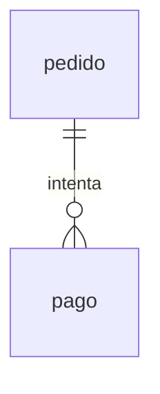

### pedido (cambios)
- `estado` admite `PENDIENTE_PAGO`. Un pedido sin pagar puede pasar a `CANCELADO`.
- `confirmado_en` admite nulos: se llena al confirmar. `pedido_confirmacion_coherente` exige que
  sea nulo en `PENDIENTE_PAGO` y no nulo desde `CONFIRMADO`.
- Nueva columna `creado_en`, porque antes el pedido nacia confirmado.

### pago
Un intento por fila. Un reintento es una fila nueva, asi cada intento queda registrado.

| Columna | Tipo | Nulo | Nota |
|---|---|---|---|
| id | bigserial | no | |
| pedido_id | bigint | no | |
| clave_idempotencia | uuid | no | Unica. La genera el frontend por intento: el mismo intento enviado dos veces no cobra dos veces |
| metodo | varchar(20) | no | Por ahora solo `TARJETA`. Un metodo local tipo Yape entra con CCPIP-183 |
| monto | numeric(12,2) | no | Mayor que cero, en soles (RNF-43), igual al total del pedido |
| estado | varchar(20) | no | `PENDIENTE`, `APROBADO`, `RECHAZADO`, `ERROR` o `ANULADO` |
| pasarela | varchar(40) | no | Por ejemplo `SIMULADA` o la de pruebas que se use |
| referencia_pasarela | varchar(100) | si | Identificador de la transaccion. Obligatoria si esta aprobado o anulado |
| marca_tarjeta | varchar(20) | si | `VISA`, `MASTERCARD`, `AMEX` o `DINERS`. Obligatoria con tarjeta |
| codigo_respuesta, mensaje_respuesta | varchar | si | Motivo del rechazo o error, para el comprador |
| creado_en, resuelto_en, anulado_en | timestamptz | | `resuelto_en` al salir de PENDIENTE; `anulado_en` solo si se anula |

**No se guarda la tarjeta**: ni numero, ni vencimiento, ni CVV. Vive en memoria mientras se
valida (Luhn, marca, CVV de 3 o 4 digitos) y se envia a la pasarela. Lo ideal es que la pasarela
tokenice desde el frontend y la tarjeta ni pase por el backend.

**Reglas en la base**, como en `movimiento_inventario`, porque una regla solo en el codigo se
salta desde cualquier cliente SQL:

- Un solo pago `APROBADO` por pedido y un solo `PENDIENTE` a la vez (indices unicos parciales).
- Solo se paga un pedido en `PENDIENTE_PAGO`, y por su total exacto (disparador al insertar).
- El estado solo avanza `PENDIENTE` -> `APROBADO` | `RECHAZADO` | `ERROR`, y `APROBADO` ->
  `ANULADO`. Un pago no se borra ni cambia de pedido, monto o clave (disparador).

**Flujo esperado:**

1. CCPIP-157 revalida precio, oferta, stock y cuenta bancaria y crea el pedido en
   `PENDIENTE_PAGO`, con el precio copiado en cada linea. No toca el stock.
2. CCPIP-62 registra el intento en `PENDIENTE`, llama a la pasarela y guarda el resultado.
3. Si sale `APROBADO`, en una sola transaccion: UPDATE condicionado del stock (RNF-10),
   movimientos `SALIDA_VENTA`, pedido `CONFIRMADO` y su historial. Si el stock ya no alcanza
   (otro comprador se lo llevo mientras se pagaba), el pedido pasa a `CANCELADO` y el pago a
   `ANULADO`, devolviendo el cobro en la pasarela.
4. Si sale `RECHAZADO` o `ERROR`, el pedido sigue en `PENDIENTE_PAGO` y se puede reintentar.

Queda fuera: vencer los pedidos que nunca se pagan (tarea programada que los pase a
`CANCELADO`), la liquidacion a cada productor y metodos locales (CCPIP-183). La comision se
copia al confirmar: ver la seccion siguiente.
Lo verifica `PagoModeloTest`.

## Comision de la Camara (CCPIP-90, CCPIP-91, CCPIP-167)

### comision_configuracion
Historial de la comision que configura el superadministrador (SA-02). Rige la fila no cancelada
con la mayor `vigente_desde` que no pase de hoy (fecha de Lima).

| Columna | Tipo | Notas |
|---|---|---|
| porcentaje | numeric(5,2) | 0 a menos de 100 |
| base_calculo | varchar(30) | Solo `PRECIO_SIN_ENVIO` hasta que CCPIP-101 defina el flete |
| vigente_desde | date | Hoy o futura (la API lo valida). Indice unico parcial: un cambio por fecha entre los no cancelados |
| motivo | varchar(300) | Obligatorio |
| registrado_por, registrado_en | | Quien y cuando |
| cancelado_por, cancelado_en | | Solo un cambio programado que aun no rige; ambos o ninguno |

Es la auditoria del cambio: un trigger impide borrarla y editarla, salvo cancelar una vez. La
migracion no siembra ningun porcentaje; el 10 % de la demo va en `R__04_comision_demo.sql` y solo
si la tabla esta vacia.

### pedido e item_pedido (columnas de comision)
Al confirmarse el pago, en la misma transaccion, se copian en el pedido
`comision_configuracion_id`, `comision_porcentaje`, `comision_base` y `comision_monto`, y en cada
linea `comision_monto` y `neto` (`subtotal - comision_monto`). El redondeo es unico: HALF_UP a 2
decimales por linea; el total del pedido es la suma de las lineas. Un pedido confirmado sin
comision configurada, o antes de esta historia, queda con las columnas nulas: no se recalcula con
un porcentaje que no regia.

Triggers: una vez copiada la comision, no cambian el total ni la comision del pedido, ni la
cantidad, precio, subtotal, comision y neto de sus lineas, y las lineas no se borran (RNF-13).

## Tarifa de cada linea y reportes B2C/B2B (CCPIP-345)

Migracion `V202610211700__item_pedido_tarifa.sql`. Los reportes del superadministrador (SA-05) separan
las ventas B2C de las B2B. Una linea es B2B cuando se vendio a tarifa mayorista, que el carrito decide
segun la modalidad de la oferta y la cantidad (`Tarifas.resolver`, CCPIP-134). El pedido ya copiaba el
precio; ahora tambien copia cual de las dos tarifas era.

| Columna | Tipo | Nulo | Nota |
|---|---|---|---|
| item_pedido.tarifa | varchar(10) | no | `MINORISTA` (B2C) o `MAYORISTA` (B2B). Por defecto `MINORISTA`. La copia la compra (RNF-13) |

Las lineas anteriores a la migracion se reconstruyen: son `MAYORISTA` si el precio copiado es el
mayorista de la oferta y distinto del minorista. La columna no esta entre los importes que protege el
disparador `item_pedido_comision_congelada`, asi que la migracion puede completarla.

Los reportes (`/api/admin/reportes/...`) agrupan por dia, semana (desde el lunes) o mes, en fechas de
Lima, con los periodos sin movimiento en cero y el acumulado del rango. Ventas: el subtotal de las
lineas de pedidos confirmados y no cancelados, por fecha de confirmacion. Comisiones (CCPIP-346): la
`comision_monto` de esas mismas lineas. Ingresos (CCPIP-93): lo cobrado, es decir los pagos `APROBADO`
por su `resuelto_en`, repartidos en B2C y B2B segun las lineas del pedido; un pago `ANULADO` no cuenta.

## Interes de compra y avisos (CCPIP-105, CCPIP-106, CCPIP-273, CCPIP-69)

### interes_compra
Intencion de compra de un consumidor en una oferta agotada o en "Venta pausada". No reserva stock, no
cobra y no mueve inventario.

| Columna | Tipo | Notas |
|---|---|---|
| usuario_id, producto_id | bigint | Indice unico parcial: un interes `PENDIENTE` por comprador y oferta; registrar otra vez cambia la cantidad |
| productor_id | bigint | Copia del productor de la oferta; un trigger impide que no coincida o que cambie |
| cantidad | integer | 1 a 9999 unidades de venta |
| motivo | varchar(20) | `AGOTADO` o `VENTA_PAUSADA`, al registrarlo |
| estado | varchar(20) | `PENDIENTE`, `AVISADO` (con `avisado_en`) o `RETIRADO` |

El productor (CCPIP-106) ve los pendientes de sus ofertas agrupados: interesados y cantidad, sin datos
de los compradores. Una tarea periodica (`ccpip.intereses.revision`, 5 min) cierra en `AVISADO` los
intereses de las ofertas que ya se pueden comprar (stock en un punto, cuenta activa y autorizacion
vigente) y avisa por correo a cada interesado (CCPIP-273).

### aviso
Registro de cada aviso a una persona: `tipo` (`PEDIDO_LISTO`, `INTERES_VENDIBLE`), `referencia_id`
(pedido o interes), `canal` (`CORREO` mientras CCPIP-103 no defina otro) y `estado` (`PENDIENTE`,
`ENVIADO`, `FALLIDO` con `error`). La clave unica `(tipo, referencia_id, usuario_id, canal)` impide
avisar dos veces lo mismo. Un correo caido queda `FALLIDO` y no detiene la operacion que lo origino.

### traduccion
Contenido aprobado en ingles (CCPIP-166 productos, CCPIP-357 tiendas, CCPIP-358 comunidades).
Adelanta el modelo de CCPIP-170. El espanol es el original y se queda en su tabla; aqui va solo
su version en ingles, campo por campo. El catalogo publico responde segun `Accept-Language` y,
si un campo no tiene traduccion aprobada, muestra el original. Quien traduce (productor, Camara o
traduccion asistida) esta pendiente de definir con el cliente, por eso cada fila nace `PENDIENTE`.

| Columna | Tipo | Nulo | Nota |
|---|---|---|---|
| id | bigserial | no | |
| entidad | varchar(20) | no | PRODUCTO, HISTORIA, TIENDA, COMUNIDAD, LINEA o UNIDAD |
| clave | varchar(60) | no | Id del producto (PRODUCTO, HISTORIA) o del productor (TIENDA, COMUNIDAD), o codigo del catalogo (LINEA, UNIDAD) |
| campo | varchar(40) | no | nombre, descripcion, titulo, texto, historia, cita o una parte de la historia |
| idioma | varchar(2) | no | Solo `en`: el espanol no se traduce |
| texto | text | no | No vacio |
| estado | varchar(14) | no | PENDIENTE, APROBADA o DESACTUALIZADA. Solo la aprobada se publica |
| aprobada_en | timestamptz | si | Obligatoria si esta APROBADA |
| origen | varchar(12) | no | COMUNIDAD (la escribio o reviso una persona) o AUTOMATICA (CCPIP-147). Por defecto COMUNIDAD |
| proveedor | varchar(40) | si | Proveedor de la traduccion automatica; obligatorio si es AUTOMATICA |
| version_original | integer | no | Version del original (`contenido_version`) desde la que se tradujo. Por defecto 1 |
| desactualizada_en | timestamptz | si | Cuando cambio el original. Obligatoria si y solo si esta DESACTUALIZADA |

Unica por (entidad, clave, campo, idioma): traducir otra vez reemplaza la fila, nunca la duplica
(CCPIP-170). Los textos en ingles de los datos de demostracion estan en
`R__03_traducciones_demo.sql`, que no reactiva una traduccion desactualizada.

### contenido_version
CCPIP-170 y CCPIP-373 (migracion `V202610171400__traduccion_version.sql`). Version de cada campo
original traducible. Sin fila, el campo esta en su version 1.

| Columna | Tipo | Nulo | Nota |
|---|---|---|---|
| entidad, clave, campo | | no | Clave primaria; mismos valores que en `traduccion` |
| version | integer | no | Sube en 1 cada vez que el productor cambia ese texto |
| actualizado_en | timestamptz | no | |

Ciclo de una traduccion:

- **CCPIP-373.** Cuando el productor cambia un texto original (nombre o descripcion del producto,
  titulo, texto o partes de la historia, nombre, descripcion, historia o cita de la tienda), sube la
  version del campo y sus traducciones pasan a DESACTUALIZADA. No se borran. El catalogo deja de
  servirlas: muestra el original y avisa que la traduccion esta desactualizada. Guardar el mismo
  texto no cuenta como cambio.
- **CCPIP-147.** La traduccion automatica nace PENDIENTE, con `origen = AUTOMATICA` y su proveedor, y
  solo se publica cuando el productor la revisa (RNF-33). Si la corrige, pasa a `origen =
  COMUNIDAD`. No reemplaza una traduccion aprobada que siga al dia. Sin proveedor responde 503 y no
  cambia nada (RNF-34).
- **CCPIP-171.** La ficha y la tienda devuelven, en otro idioma, `traducciones` por campo con su
  origen, si esta vigente y el texto original para "Ver original".

## Registro y verificacion del correo (CCPIP-26, CCPIP-328)

Migracion `V202610140800__registro_consumidor.sql`. El consumidor crea su cuenta con nombres,
apellidos (se guardan juntos en `usuario.nombre`), correo, celular opcional y contrasena. La
cuenta nace con `correo_confirmado = false` y el inicio de sesion la rechaza con
`CORREO_NO_CONFIRMADO` hasta que use el enlace que le llega por correo.

### token_un_uso
Enlaces de un solo uso. Se comparte con la recuperacion de contrasena (CCPIP-33), que usara el
proposito `RECUPERAR_CLAVE`. Como en `sesion`, solo se guarda el SHA-256 del token.

| Columna | Tipo | Nulo | Nota |
|---|---|---|---|
| id | bigserial | no | |
| usuario_id | bigint | no | Indexado junto con `proposito`, para reenviar |
| proposito | varchar(30) | no | `VERIFICAR_CORREO` o `RECUPERAR_CLAVE` |
| token_hash | char(64) | no | Unico. El token en claro solo viaja en el correo |
| creado_en | timestamptz | no | |
| expira_en | timestamptz | no | Posterior a `creado_en`. Por defecto, 24 horas |
| usado_en | timestamptz | si | Nulo mientras no se use. Un enlace usado ya no sirve |

- Usar el enlace es un UPDATE condicionado (`usado_en IS NULL`): si llegan dos usos a la vez,
  solo uno confirma.
- Reenviar borra los enlaces de verificacion sin usar de la cuenta y emite uno nuevo, como mucho
  uno por minuto. La respuesta es la misma exista o no la cuenta, para no revelar que correos
  estan registrados.
- El enlace no inicia sesion: la persona ingresa con su contrasena despues de verificar.

## Cuentas de la administracion (CCPIP-95, 124, 125, 301 a 308)

Migracion `V202610172000__cuentas_administracion.sql`. El superadministrador crea, modifica y
desactiva cuentas de sub administrador y de administrador de punto de acopio (SA-03, SA-04); un
administrador autorizado busca, suspende y reactiva cuentas segun el alcance de su rol. Ninguna
cuenta se borra (RNF-18): cambia `usuario.estado` y el cambio queda en `cuenta_historial`.

- `usuario.estado`: `ACTIVA`, `SUSPENDIDA` (se reactiva) o `DESACTIVADA` (definitiva). `activo` se
  conserva porque el inicio de sesion y la validacion de sesiones lo leen; una restriccion los
  mantiene coherentes. Al dejar de estar activa se borran sus sesiones y sus enlaces sin usar.
- Alcance (en el servidor, `AlcanceCuentas`): el superadministrador ve todas las cuentas menos las
  de superadministradores; el sub administrador, solo consumidores, productores y distribuidores.
  Nadie actua sobre su propia cuenta. El rol y el correo no se modifican.
- Alta segura: la cuenta nace con el hash de una clave aleatoria que nadie conoce y
  `correo_confirmado = false`; la persona elige su contrasena con un enlace de `token_un_uso`
  (proposito `RECUPERAR_CLAVE`, vigencia `ccpip.cuentas.enlace-acceso-vigencia`, 72 h).
- Puntos: el administrador de punto tiene al menos un punto de acopio activo en
  `usuario_ubicacion`; el sub administrador ninguno. Los cambios de asignacion quedan en el historial.

### cuenta_historial
Solo insercion: un trigger impide editarla y borrarla.

| Columna | Tipo | Nulo | Nota |
|---|---|---|---|
| id | bigserial | no | |
| usuario_id | bigint | no | Cuenta afectada. Indexado con `realizado_en` |
| accion | varchar(20) | no | `CREAR`, `MODIFICAR`, `SUSPENDER`, `REACTIVAR`, `DESACTIVAR` o `REENVIAR_ACCESO` |
| motivo | varchar(300) | si | Obligatorio para suspender, reactivar y desactivar |
| cambios | jsonb | si | Antes y despues (nombre, telefono, puntos, estado). Nunca contrasenas ni tokens |
| realizado_por | bigint | no | Quien hizo el cambio |
| realizado_en | timestamptz | no | |

## Transferencias entre ubicaciones (CCPIP-73, 146, 164, 362, 277, 278)

RNF-47: el productor lleva existencias de su almacen a un punto de acopio (CCPIP-73) o solicita
moverlas entre puntos (CCPIP-277); el administrador del punto de destino las recibe y consulta su
estado e historial (CCPIP-278). Migracion `V202610171700__transferencia.sql`.

Las unidades no se duplican ni se pierden: saldo de los lotes de origen + unidades preparadas + en
transito + lotes de destino se conserva. Solo `lote.cantidad_actual` cambia, siempre con su
movimiento y su stock en la misma transaccion (RNF-15, ADR-10):

| Paso | Estado | Lote | Movimiento |
|---|---|---|---|
| Iniciar (almacen a punto) | INICIADA | no cambia | ninguno |
| Solicitar (entre puntos) | SOLICITADA | no cambia | ninguno; no avanza hasta que se defina quien aprueba (C8) |
| Preparar (CCPIP-164) | PREPARADA | el de origen baja | TRANSFERENCIA_SALIDA por linea |
| Despachar (CCPIP-362) | DESPACHADA | no cambia: ya se desconto | ninguno; en transito no se vende |
| Recibir (CCPIP-278) | RECIBIDA | se crea uno en el destino, con el vencimiento del origen | TRANSFERENCIA_ENTRADA por linea |

### transferencia
| Columna | Tipo | Nulo | Nota |
|---|---|---|---|
| tipo | varchar(20) | no | ALMACEN_A_PUNTO o ENTRE_PUNTOS |
| productor_id | bigint | no | RNF-05: el productor solo ve y opera las suyas |
| origen_id, destino_id | bigint | no | Ubicaciones distintas (CHECK) |
| estado | varchar(20) | no | INICIADA, SOLICITADA, PREPARADA, DESPACHADA, RECIBIDA |
| observacion | varchar(255) | si | |
| creada_por | bigint | si | Usuario |

### transferencia_item, transferencia_historial
`transferencia_item` guarda producto, lote de origen, cantidad y, al recibir, el lote de destino. Un
lote va una sola vez por transferencia. `transferencia_historial` registra cada cambio de estado con
quien y cuando.

### movimiento_inventario (cambios)
- `transferencia_item_id`: la linea de transferencia del movimiento. Un CHECK exige linea y lote en
  todo movimiento TRANSFERENCIA_ENTRADA o TRANSFERENCIA_SALIDA.
- Indice unico `(transferencia_item_id, tipo)`: una linea sale una sola vez y entra una sola vez; un
  segundo intento choca en la base en vez de descontar o sumar dos veces.
- `tipo` pasa a varchar(30): TRANSFERENCIA_ENTRADA tiene 21 caracteres y no cabia.

El administrador del punto ve lo que entra o sale de los puntos de `usuario_ubicacion`, salvo lo
que el productor aun no compromete (INICIADA). Solo el destino registra la recepcion.

## Calificaciones y denuncias (CCPIP-81, CCPIP-82, CCPIP-83, CCPIP-84, CCPIP-116, CCPIP-323)

Migraciones `V202610172500__calificacion.sql`, `V202610172501__denuncia.sql` y
`V202610172502__parametro_minimo_calificaciones.sql`.

### calificacion
CCPIP-81 (RF-88): el comprador califica con 1 a 5 estrellas cada linea de un pedido que recibio. Una
calificacion por linea (`item_pedido`): tres unidades en la misma linea cuentan como una. Solo
insercion: no se edita ni se borra.

| Columna | Tipo | Nulo | Nota |
|---|---|---|---|
| id | bigserial | no | |
| item_pedido_id | bigint | no | Unico. La linea calificada |
| pedido_id | bigint | no | |
| producto_id, productor_id | bigint | no | Copiados de la linea; llave foranea a la oferta (CCPIP-172) |
| usuario_id | bigint | no | Comprador. Nunca sale en la ficha ni al productor |
| estrellas | smallint | no | De 1 a 5 |
| comentario | varchar(500) | si | Opcional. Se publica sin nombre |
| calificado_en | timestamptz | no | |

- Compra verificada en la base: un trigger exige que la linea sea del mismo comprador, que el pedido
  este `ENTREGADO` y que producto y productor coincidan con la linea. El servicio valida lo mismo
  antes y responde `PEDIDO_NO_RECIBIDO` o `LINEA_YA_CALIFICADA`.
- CCPIP-82 (RF-89): el promedio de una oferta se calcula al consultar (`avg(estrellas)`, a un decimal)
  y solo se publica con un minimo de calificaciones. El minimo es el parametro de SA-02
  `CALIFICACIONES_MINIMO_PROMEDIO` en `parametro_plataforma` (migracion
  `V202610172502__parametro_minimo_calificaciones.sql`, que amplia el CHECK de claves; lo fija el
  superadministrador en `/api/admin/parametros/minimo-calificaciones`). Mientras no lo fije rige el
  provisional `ccpip.calificaciones.minimo-para-promedio` (3). Con menos, la respuesta trae el conteo y
  el umbral, sin promedio, distribucion ni resenas: nunca un promedio cero.

### denuncia
CCPIP-83 (RF-90): denuncia de un comprador sobre una oferta (`producto_id`) o sobre la comunidad
(`producto_id` nulo), con motivo y descripcion, sin aprobacion previa. Nunca se borra.

| Columna | Tipo | Nulo | Nota |
|---|---|---|---|
| id | bigserial | no | |
| denunciante_id | bigint | no | RNF-41: identidad protegida, no sale en ninguna respuesta |
| productor_id | bigint | no | Denunciado. Con producto, el de esa oferta (llave foranea compuesta) |
| producto_id | bigint | si | Nulo si se denuncia a la comunidad |
| motivo | varchar(30) | no | `NO_CORRESPONDE`, `CALIDAD`, `ORIGEN_DUDOSO`, `PRACTICA_INDEBIDA`, `CONTENIDO_INAPROPIADO`, `OTRO` |
| descripcion | varchar(1000) | no | Al productor y al subadministrador llega con correos y telefonos ocultos |
| estado | varchar(20) | no | `RECIBIDA`, `EN_REVISION`, `RESUELTA`, `DESESTIMADA` |
| respuesta_productor | varchar(1000) | si | CCPIP-323: una sola vez, mientras la denuncia este abierta |
| respondida_en | timestamptz | si | Nula si y solo si no hay respuesta |
| creada_en, actualizada_en | timestamptz | no | |

- Lo denunciado (denunciante, productor, oferta, motivo, descripcion, fecha) no cambia despues de
  registrar, y la respuesta no se reemplaza: lo impide un trigger. DELETE esta bloqueado.
- Un comprador no tiene dos denuncias abiertas sobre lo mismo (`DENUNCIA_DUPLICADA`).
- Transiciones del subadministrador: `RECIBIDA` a `EN_REVISION`, `RESUELTA` o `DESESTIMADA`;
  `EN_REVISION` a `RESUELTA` o `DESESTIMADA`. Cerrada, ya no cambia.

### denuncia_evento
Historial y auditoria de cada denuncia. Solo insercion.

| Columna | Tipo | Nulo | Nota |
|---|---|---|---|
| id | bigserial | no | |
| denuncia_id | bigint | no | |
| tipo | varchar(20) | no | `REGISTRADA`, `RESPUESTA`, `CAMBIO_ESTADO` |
| estado | varchar(20) | no | Estado de la denuncia despues del evento |
| nota | varchar(1000) | si | Respuesta del productor o nota obligatoria del subadministrador |
| usuario_id | bigint | no | Quien dio el paso. En `REGISTRADA` es el denunciante y no se expone |
| rol | varchar(20) | no | `CONSUMIDOR`, `PRODUCTOR` o `SUB_ADMIN` |
| registrado_en | timestamptz | no | |

Que ve cada rol (filtrado en el servidor, RNF-05 y RNF-41):

- **Comprador:** sus propias denuncias, con estado y respuesta del productor.
- **Productor (CCPIP-116):** solo las de su productor de sesion; sin denunciante, sin hora (solo el
  dia) y con correos y telefonos de la descripcion ocultos.
- **Subadministrador (CCPIP-84):** bandeja por productor ordenada por cantidad de denuncias, separada
  del tablero analitico, y el historial con el nombre del subadministrador en cada cambio de estado.
  Del denunciante solo sabe si recibio algun pedido de ese productor (`compraVerificada`). El
  superadministrador consulta en modo lectura.

## Fuera de este modelo

Se modela cuando llegue su sprint, y el modelo actual admite agregarlo sin rehacer nada:

- Catalogo territorial completo y declaracion de la cobertura por cada punto (CCPIP-149, 401, 402, 403). CCPIP-59 trae un ubigeo provisional y lo minimo de la cobertura
- Liquidacion y transferencia a cada productor (PW-11)
- Merma y sus causas, Sprint 2
- Fidelizacion, Sprint 3, CCPIP-86

## Convencion de nombres de las migraciones

Las versiones son **fecha y hora de creacion**, en formato `YYYYMMDDHHMM`, no numeros
secuenciales:

```
V202610020032__usuario_rol.sql
V202610051432__agregar_lote.sql
```

El motivo es concreto. Con numeros secuenciales, dos personas que salen de main crean
las dos `V6__`, y al fusionar el segundo PR hay dos V6. Flyway falla con version
duplicada, el segundo tiene que renombrar, y quien ya corrio su V6 local queda con el
historial desalineado. Con diez integrantes y varios PR al dia eso pasa cada semana.

Con fecha y hora no colisionan, porque nadie crea el archivo en el mismo minuto, y si
pasara se nota de inmediato en el PR. El orden sigue siendo determinista: Flyway compara
las versiones numericamente.

Las repetibles usan el prefijo `R__`, que en Flyway significa repetible: se aplican
despues de todas las migraciones versionadas y se vuelven a aplicar cuando cambia su
contenido. Eso es exactamente lo que queremos para datos sembrados idempotentes.

- `db/migration/R__01_catalogos_base.sql`: roles, catalogos y puntos de acopio. Corre en
  todos los ambientes, porque sin ellos la aplicacion no funciona.
- `db/seed/R__02_cuentas_productores_productos.sql`: una cuenta de demostracion por rol
  (clave publica `Demo1234!`, ver docs/devsecops.md), productores y productos. Corre en
  todos los ambientes porque las revisiones de sprint y la prueba de humo del despliegue
  usan esas cuentas. Para un ambiente sin demo basta quitar `db/seed` de
  `spring.flyway.locations`.
  Las existencias iniciales entran como lote, movimiento de ENTRADA ligado a ese lote y
  stock, en un solo comando (CCPIP-361). La autorizacion, la historia aprobada y las
  existencias solo se siembran para los diez productos de la semilla: un producto creado
  desde la plataforma no las recibe aunque la semilla vuelva a correr. Lo verifica
  `SemillasTest`. El
numero en `R__01_` y `R__02_` fija el orden, porque las repetibles corren en orden
alfabetico y la segunda depende de la primera.

### Lo que la fecha y hora no resuelve

Dos personas pueden agregar en paralelo una columna a la misma tabla. Los archivos no
colisionan, pero la segunda migracion puede asumir un estado que la primera no dejo.
Eso no lo arregla ninguna herramienta, se arregla en la revision del PR y corriendo
`docker compose down -v` despues de traer main, que reconstruye desde cero y lo revienta
de inmediato si hay conflicto.

## Pendiente de aprobacion del equipo

El criterio de aceptacion de CCPIP-19 dice que ninguna migracion se escribe antes de que
este modelo este aprobado. Las migraciones ya estan escritas y probadas, asi que lo que
falta es que el equipo lo revise. Si cambia algo, se corrige antes de que alguien mas
corra V1 a V5, porque despues ya no se puede editar un archivo aplicado.

## Administracion del catalogo maestro (CCPIP-96, 309, 310, 311, 351, 312, 313 y 314)

Migracion `V202610172300`, sobre `producto_maestro` y `producto.producto_maestro_id` de CCPIP-42
(`V202610171900`, seccion anterior). El catalogo maestro son las lineas y los productos de
referencia de la Camara. **No es la oferta comercial**: una oferta es una fila de `producto` de un
productor, con su propio nombre, precio, lineas y estado (CCPIP-172). Lo administra el
superadministrador (`/api/admin/catalogo`, Figma: modulo "lineas" del superadministrador); los
demas roles reciben 403.

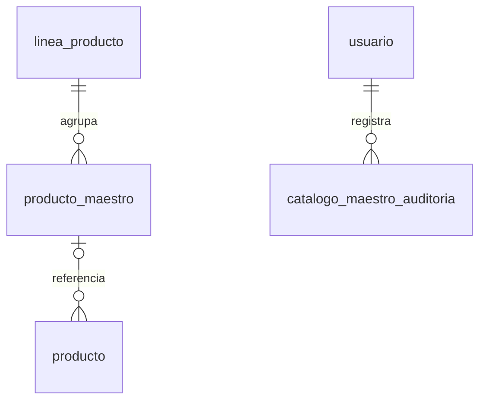

Nada se borra (RNF-17, RNF-18): `linea_producto` y `producto_maestro` tienen un trigger que rechaza
DELETE; se desactivan con `activo = false`, y otro trigger llena o limpia `desactivado_en` cada vez
que cambia `activo`.

### linea_producto (columnas nuevas)
| Columna | Tipo | Nulo | Nota |
|---|---|---|---|
| creado_en, actualizado_en | timestamptz | no | |
| desactivado_en | timestamptz | si | Desde cuando esta inactiva. `activo = (desactivado_en IS NULL)` |

El `codigo` no cambia (trigger): es la clave de las traducciones (`traduccion.entidad = 'LINEA'`) y de
las validaciones de imagen. El nombre es unico sin importar mayusculas ni tildes. El nombre en ingles
lo escribe el superadministrador y se guarda como traduccion APROBADA; si cambia el nombre en espanol
sin dar uno nuevo en ingles, la traduccion queda DESACTUALIZADA (CCPIP-373). R__01 ya no pisa lo que
la Camara edito (`ON CONFLICT DO NOTHING`).

Una linea inactiva sale de `/api/catalogos` (formularios del productor y del consumidor) y del
tablero, y no recibe productos maestros nuevos. Las ofertas que ya la tienen la conservan, se siguen
mostrando con ella y el productor puede guardarlas sin quitarla, pero no elegirla para otra oferta.

### producto_maestro (columnas y reglas nuevas)
| Columna | Tipo | Nulo | Nota |
|---|---|---|---|
| actualizado_en | timestamptz | no | |
| desactivado_en | timestamptz | si | `activo = (desactivado_en IS NULL)` |

El `codigo` (CCPIP-42) se valida (`^[A-Z0-9][A-Z0-9_-]{1,39}$`) y no cambia (trigger). El nombre es
unico dentro de su linea sin importar mayusculas ni tildes. Un producto maestro nace en una linea
activa; puede quedarse en su linea si esta se desactiva, pero no pasar a otra inactiva.

No tiene precio, unidad, stock ni productor. Modificarlo solo escribe su fila (CCPIP-313): las
ofertas que lo referencian conservan nombre, precio y lineas, y los pedidos su copia de precio
(RNF-13). Desactivarlo (CCPIP-314) no desvincula ni pausa ninguna oferta; el publico deja de verlo en
`GET /api/maestros/{id}` (404, regla de CCPIP-42) mientras sus ofertas siguen en el catalogo.
Reactivarlo exige que su linea este activa.

### catalogo_maestro_auditoria
`entidad` (LINEA o PRODUCTO), `entidad_id`, `usuario_id`, `accion` (CREAR, EDITAR, DESACTIVAR,
REACTIVAR), `cambios` (jsonb: la foto al crear, `{campo: {antes, despues}}` al editar, las ofertas y
productos conservados al desactivar) y `registrado_en`. Solo insercion (triggers), igual que
`producto_auditoria`.

## Bloqueo de las ventas de un productor (CCPIP-85, CCPIP-322)

Migracion `V202610221200`. El subadministrador bloquea (RF-78) o desbloquea (RF-215) con motivo las
ventas de un productor. Es una medida de gobernanza, que en el Figma se toma desde las denuncias
(S-03 y S-04), distinta de la revocacion de CCPIP-330, que es de cumplimiento. Por eso tiene su
propio estado: desbloquear no restituye una venta revocada ni restituir levanta un bloqueo.

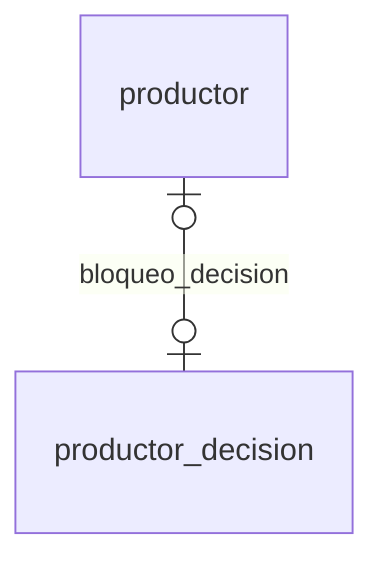

**Una oferta es comprable** ahora, ademas de lo anterior, solo si la venta de su productor no esta
bloqueada. Igual que la revocacion: la regla vive en `CatalogoRepository.HABILITADA`, la oferta sigue
visible en Venta pausada y los pedidos confirmados no se tocan. El productor recibe el aviso
(`DECISION_PRODUCTOR`) y ve el bloqueo y su motivo en Mi tienda.

| Decision | Quien | Exige | Efecto |
|---|---|---|---|
| Bloquear (`POST /api/admin/productores/{id}/bloquear`) | SUB_ADMIN | no bloqueado, si no `409 VENTA_YA_BLOQUEADA` | `productor.venta_bloqueada`; fila BLOQUEAR_VENTA en `productor_decision` con las autorizaciones vigentes como alcance |
| Desbloquear (`.../desbloquear`) | SUB_ADMIN | bloqueado, si no `409 VENTA_NO_BLOQUEADA` | Vuelve a vender lo que tenia autorizado, salvo que ademas este revocado |
| Habilitar tienda (`.../habilitar-tienda`) | SUB_ADMIN | ademas de lo de CCPIP-291, no bloqueado (`409 VENTA_BLOQUEADA`) | Igual que con la revocacion: la ficha no ofrece habilitarla mientras dure el bloqueo |

Revocacion y bloqueo son independientes, asi que el aviso de restituir o desbloquear solo dice que los
productos vuelven a la venta si la otra restriccion no sigue vigente. Si sigue, el correo lo explica
(`AvisoAutorizacion.Tipo` `RESTITUIR_VENTA_SIGUE_BLOQUEADA` y `DESBLOQUEAR_VENTA_SIGUE_REVOCADA`).

### productor_decision (cambios)
`decision` pasa a `varchar(20)` y admite tambien `BLOQUEAR_VENTA` y `DESBLOQUEAR_VENTA`. Bloquear y
desbloquear tambien dejan una fila `AUTORIZACION` en `producto_auditoria` de cada producto alcanzado.

### productor (columnas nuevas)
| Columna | Tipo | Nula | Descripcion |
|---|---|---|---|
| venta_bloqueada | boolean | no | La venta del productor esta bloqueada. Independiente de `venta_revocada` |
| bloqueo_decision_id | bigint | si | Ultimo bloqueo o desbloqueo |

## Entrega a domicilio desde un punto de acopio (CCPIP-59)

Migracion `V202610231000`. El comprador puede pedir que el pedido llegue a su direccion en lugar de
recogerlo (RF-40). Sigue el paquete *Entrega y territorio* del diccionario de datos del proyecto
(`ubigeo`, `cobertura_entrega`, `entrega`) y entra solo lo que esa eleccion necesita; la declaracion de la
cobertura por cada punto (CCPIP-149, 401, 402, 403), la validacion previa al pago (CCPIP-60), las
direcciones guardadas (CCPIP-61, 65, 393 a 395) y el reparto (CCPIP-107 a 110) llegan con sus historias.

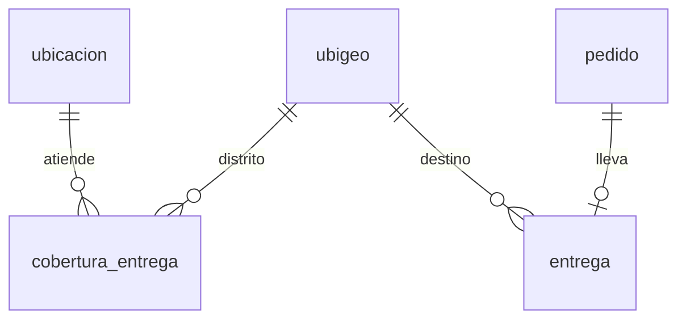

### ubigeo
| Columna | Tipo | Nula | Descripcion |
|---|---|---|---|
| codigo | char(6) | no | PK. Ubigeo del INEI; seis digitos (CHECK) |
| departamento, provincia, distrito | varchar(80) | no | |

El contenido es **provisional** (`R__05_ubigeo_provisional.sql`): solo los distritos de las zonas donde
hay puntos de acopio. El catalogo territorial completo y aprobado lo carga CCPIP-149 y lo reemplaza.

### cobertura_entrega
| Columna | Tipo | Nula | Descripcion |
|---|---|---|---|
| id | bigserial | no | |
| ubicacion_id | bigint | no | El punto de acopio que atiende el distrito |
| ubigeo | char(6) | no | Distrito atendido |
| activa | boolean | no | Una zona desactivada no se ofrece ni se acepta, y no se borra |
| actualizado_en | timestamptz | no | |

Unica por `(ubicacion_id, ubigeo)`. La semilla `R__06_cobertura_demo.sql` da una cobertura de ejemplo para
la demo.

### entrega
Una por pedido con modalidad `ENVIO` (`pedido_id` unico).

| Columna | Tipo | Nula | Descripcion |
|---|---|---|---|
| pedido_id | bigint | no | Pedido que se entrega |
| distribuidor_id | bigint | si | Nulo hasta que un distribuidor la asume (CCPIP-107 a 110) |
| ubigeo | char(6) | no | Distrito de destino; el punto de origen lo cubre al crear el pedido |
| direccion, referencia | varchar(255) | no, si | Destino y referencia opcional |
| contacto_nombre, contacto_celular | varchar | no | Quien recibe; el celular, de 9 digitos que empiezan con 9 (CHECK) |
| estado | varchar(12) | no | `DISPONIBLE`, `ASIGNADA`, `RETIRADA`, `EN_CAMINO`, `ENTREGADA`. Nace `DISPONIBLE` |
| asignada_en, retirada_en, entregada_en, creado_en | timestamptz | si, si, si, no | |

**Reglas.** El pedido sale siempre de `pedido.ubicacion_origen_id`, el punto de acopio con existencias
para todo el carrito, y solo llega a distritos que ese punto cubre: el productor no entrega al comprador.
Un pedido `ENVIO` no tiene persona autorizada. **El total del pedido sigue siendo la suma de sus lineas**:
el costo del envio depende de una definicion pendiente del cliente (CCPIP-101) y no se modela todavia. El
punto puede preparar un pedido a domicilio, pero no marcarlo listo para recojo ni registrar su recojo
(`409 PEDIDO_A_DOMICILIO`): su despacho es de las historias de distribucion.

| Endpoint | Rol | Descripcion |
|---|---|---|
| `GET /api/compra/distritos` | CONSUMIDOR | Distritos a los que se entrega todo el carrito, cada uno con los puntos que lo cubren y tienen existencias para todas sus lineas. **No esta en el contrato de la API; hay que agregarlo** |
| `POST /api/pedidos` con `modalidad: "ENVIO"` y `entrega` | CONSUMIDOR | Crea el pedido a domicilio. Sin `modalidad` es `RECOJO`, como antes. `409 SIN_COBERTURA` si el punto no cubre el distrito |

## Datos territoriales del destino (CCPIP-61)

Sin tablas nuevas: el comprador indica el destino de su pedido a domicilio (RF-42) eligiendo departamento,
provincia y distrito del catalogo `ubigeo` y escribiendo la direccion, sin depender de mapas (RNF-31). El
contacto y la direccion se guardan en `entrega`, como en CCPIP-59.

| Endpoint | Rol | Descripcion |
|---|---|---|
| `GET /api/territorio/departamentos` | CONSUMIDOR | Departamentos del catalogo, ordenados |
| `GET /api/territorio/provincias?departamento=` | CONSUMIDOR | Provincias del departamento. `422 TERRITORIO_INCOMPLETO` sin el departamento |
| `GET /api/territorio/distritos?departamento=&provincia=` | CONSUMIDOR | Distritos de la provincia, con su `ubigeo`. `422 TERRITORIO_INCOMPLETO` si falta alguno |

**Direccion.** Como nadie la confirma en un mapa, se pide completa: al crear el pedido a domicilio debe tener
al menos 5 caracteres y una letra, si no `422 DIRECCION_INVALIDA`. "Mz. A Lt. 3" vale; "12345" no.

Estos endpoints **no estan en el contrato de la API** del Drive; hay que agregarlos. El catalogo es el
provisional de CCPIP-59 hasta que CCPIP-149 cargue el completo. Los destinos internacionales dependen de reglas
pendientes del cliente (decision C9) y no se incluyen.

## Historial de acciones de gobernanza (CCPIP-126)

Sin migracion. RF-85: el subadministrador consulta sus propias acciones de gobernanza (Figma S-05)
con `GET /api/admin/mi-historial?desde&hasta&tipo` (solo SUB_ADMIN; el autor sale de la sesion).
Cada modulo ya registra sus acciones con autor, fecha y motivo en tablas de solo insercion o de un
unico cambio de estado; `HistorialGobernanzaService` las junta con `UNION ALL` y no copia nada, asi
que el historial no se puede alterar y una accion nueva de esos modulos aparece sola.

| Tipo | Tabla de origen | Autor | Accion | Sobre |
|---|---|---|---|---|
| AUTORIZACIONES | `autorizacion_decision` | `decidido_por` | `AUTORIZACION_` + APROBADA, RECHAZADA o REVOCADA | Productor y producto |
| AUTORIZACIONES | `renovacion_certificado` | `solicitada_por` | `RENOVACION_SOLICITADA` | Productor y producto |
| PRODUCTORES | `productor_decision` | `decidido_por` | `HABILITAR_TIENDA`, `REVOCAR_VENTA`, `RESTITUIR_VENTA`, `BLOQUEAR_VENTA`, `DESBLOQUEAR_VENTA` | Productor |
| DENUNCIAS | `denuncia_evento` (CAMBIO_ESTADO del SUB_ADMIN) | `usuario_id` | `DENUNCIA_` + EN_REVISION, RESUELTA o DESESTIMADA | Productor y numero de denuncia |
| CUENTAS | `cuenta_historial` | `realizado_por` | `CUENTA_` + SUSPENDER, REACTIVAR, ... | Titular de la cuenta |

El periodo es por fecha de Lima, por defecto los ultimos 30 dias y como maximo un año
(`RangoFechas`, `422 RANGO_INVALIDO` o `RANGO_MUY_LARGO`). El servicio admite autor nulo para
consultar las acciones de todos, pensado para la auditoria de CCPIP-97.
## Salida de un pedido a domicilio del punto de acopio (CCPIP-320)

Migracion `V202610231200`. El administrador del punto de acopio registra que un pedido a domicilio preparado
sale de su punto para despacho (RF-202): el pedido pasa de `EN_PREPARACION` a `LISTO_PARA_DESPACHO`, el estado
del diccionario de datos para un pedido preparado que retirara un distribuidor. Es el equivalente de
`LISTO_PARA_RECOJO` (CCPIP-159) para un pedido de modalidad `ENVIO`. Entra solo ese estado en
`pedido_estado_valido`; consultarlo y asumirlo (CCPIP-107 y 108), retirarlo (CCPIP-109) y los estados de
camino (CCPIP-318 y 319) llegan con sus historias.

| Endpoint | Rol | Descripcion |
|---|---|---|
| `POST /api/acopio/pedidos/{numero}/despacho` | ADMIN_PUNTO | Marca un pedido a domicilio en preparacion de sus puntos como listo para despacho |

**Transicion autorizada.** Solo desde `EN_PREPARACION` y solo un pedido `ENVIO`: uno para recojo responde
`409 PEDIDO_PARA_RECOJO`, y cualquier otro estado `409 ESTADO_INVALIDO` sin dejar rastro en el historial. Un pedido
de otro punto no existe para el administrador (`404`, RNF-05). El pedido se bloquea con `FOR UPDATE`, asi dos
clics simultaneos no registran la salida dos veces.

**Usuario y fecha.** Cada salida queda en `pedido_estado_historial` con el administrador que la registro y
la fecha. La entrega (`entrega.estado`) sigue `DISPONIBLE`: la cambia el distribuidor al asumirla.

**Inventario.** Registrar la salida no mueve unidades ni crea movimientos: el descuento ocurrio al confirmar
la compra (CCPIP-158) y no se repite al despachar ni cuando el distribuidor retire el pedido.

**Otras consultas del pedido.** El tablero del punto (`GET /api/acopio/pedidos`) lista los pedidos
`LISTO_PARA_DESPACHO` junto a los listos para recojo. La consulta de pedidos del productor lo presenta como
`LISTO_PARA_RECOJO` (listo en el punto de acopio) en el conteo, el filtro, la lista y el historial, para no fallar al
contarlo por estado. La comision por pedido admite filtrar por el estado nuevo y la liquidacion en Excel lo
nombra "Listo para despacho".

## Direcciones de entrega guardadas (CCPIP-65)

Migracion `V202610231400`. El comprador guarda sus direcciones de entrega habituales (RF-46) para no escribirlas
en cada compra. Sigue la tabla `direccion_guardada` del modelo de datos del proyecto; consultarlas (CCPIP-393),
modificarlas (CCPIP-394) y retirarlas (CCPIP-395) llegan con sus historias.

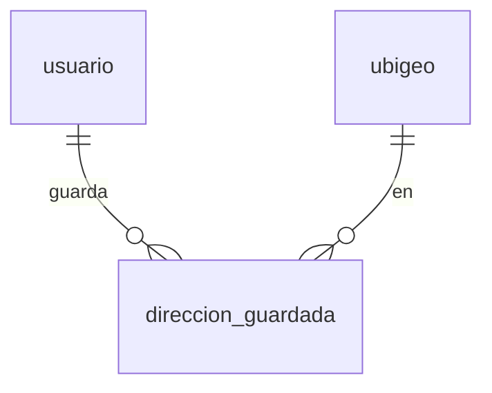

### direccion_guardada
| Columna | Tipo | Nula | Descripcion |
|---|---|---|---|
| id | bigserial | no | |
| usuario_id | bigint | no | El comprador, siempre el de la sesion: nunca se recibe de la peticion (RNF-05) |
| alias | varchar(40) | si | Nombre corto, por ejemplo "Casa" |
| ubigeo | char(6) | no | Distrito del catalogo territorial: un destino admitido |
| direccion | varchar(255) | no | Calle y numero |
| referencia | varchar(255) | si | Para ubicar la direccion |
| activa | boolean | no | Retirarla la marca inactiva sin borrarla (CCPIP-395) |
| creado_en | timestamptz | no | |

| Endpoint | Rol | Descripcion |
|---|---|---|
| `POST /api/cuenta/direcciones` | CONSUMIDOR | Guarda una direccion del comprador. `201` con la direccion y su distrito, provincia y departamento |

**Reglas.** Solo datos propios: el comprador sale de la sesion. Solo destinos admitidos: un distrito que no esta
en el catalogo responde `422 DESTINO_NO_ADMITIDO`. La direccion se pide completa, como en el pedido a domicilio
(`422 DIRECCION_INVALIDA`). La misma direccion en el mismo distrito no se guarda dos veces para un comprador
(`409 DIRECCION_YA_GUARDADA`, sin distinguir mayusculas); otro comprador si puede guardarla. Los pedidos copian su
destino en `entrega` y no dependen de esta tabla.

## Aceptar y editar el borrador de descripcion de la IA (CCPIP-49)

Migracion `V202610241300`. El productor edita el borrador de descripcion que propone la IA (RF-73, RNF-29): la IA
no publica nada, la aceptacion queda registrada y se conservan la version sugerida y la final, como ya ocurria con
la historia (`producto_historia`). Nuevas columnas en `producto`:

| Columna | Tipo | Nula | Descripcion |
|---|---|---|---|
| descripcion_sugerida | text | si | La sugerencia de la IA que el productor acepto, tal como la propuso. La final, editada, es `descripcion` |
| descripcion_aceptada_en | timestamptz | si | Cuando la acepto |
| descripcion_aceptada_por | bigint | si | Quien la acepto |

Las tres van juntas (CHECK `producto_descripcion_aceptada_completa`). `descripcion_propuesta` queda como el
borrador **pendiente** de decision: al aceptarlo pasa a `descripcion_sugerida`, y pedir otra version o descartarla
(CCPIP-280) ya no borra la sugerencia que el productor habia aceptado.

| Endpoint | Rol | Descripcion |
|---|---|---|
| `POST /api/productor/productos/{id}/ia/descripcion/aceptar` | PRODUCTOR | Acepta el borrador pendiente para editarlo. Devuelve el producto con `descripcionSugerida`. `409 SIN_BORRADOR` si no hay borrador; un producto ajeno, `404`. **No esta en el contrato de la API; hay que agregarlo** |

**Reglas.** Aceptar no cambia `descripcion` ni publica nada: la version final es la que el productor guarde despues
con `PUT /api/productor/productos/{id}`. Cada aceptacion queda en `producto_auditoria` (`EDITAR`, con
`descripcionIaAceptada` y el texto sugerido), junto a los rechazos de CCPIP-280. `descripcion_asistida` solo se
marca si el productor acepto una sugerencia (o ya era asistida); un borrador pendiente sin aceptar ya no basta.

**Datos existentes.** La migracion pasa a `descripcion_sugerida` la propuesta de las descripciones ya marcadas como
asistidas, con la fecha y el responsable de la ultima edicion del producto, que es la mejor evidencia disponible.

## Umbrales de merma por linea (CCPIP-430)

Migracion `V202610251300`. Mejora de la sesion de laboratorio del 22/10: el tablero del superadministrador
(SA-01) colorea la merma del mes de cada punto de acopio segun el nivel de perdida. Lo que es normal depende de
que tan perecible es lo que agrupa cada linea (la fruta se pierde mas que el grano), asi que cada linea del
catalogo maestro tiene sus umbrales. El equipo acordo el 25/10 que nazcan en 5 % y 10 % y que el
superadministrador los cambie en Catalogo maestro > Lineas: no hay un valor por defecto escondido.

### linea_producto (columnas nuevas)
| Columna | Tipo | Nula | Descripcion |
|---|---|---|---|
| merma_umbral_alerta | numeric(4,1) | no | % de merma del mes desde el que la linea se ve en alerta. Nace en 5 |
| merma_umbral_critico | numeric(4,1) | no | % de merma del mes desde el que la linea se ve en estado critico. Nace en 10 |

La base exige `0 < alerta < critico <= 100` (`linea_producto_umbrales_merma_validos`).

| Endpoint | Rol | Descripcion |
|---|---|---|
| `GET /api/admin/catalogo/lineas` | SUPER_ADMIN | Cada linea trae `mermaUmbralAlerta` y `mermaUmbralCritico` |
| `POST /api/admin/catalogo/lineas`, `PUT /api/admin/catalogo/lineas/{id}` | SUPER_ADMIN | Aceptan los dos umbrales, opcionales: nulo conserva el actual (al crear, 5 y 10). Hasta un decimal, entre 0.1 y 100 (`400`); la alerta menor que el critico (`422 UMBRALES_MERMA_INVALIDOS`). El cambio queda en `catalogo_maestro_auditoria` |
| `GET /api/admin/tablero` | SUPER_ADMIN | `puntos[].merma` (`unidades`, `porcentaje`, `nivel`) y `mermaPorLinea[]` |

**Calculo.** El % de merma de una linea en un punto es la merma del mes (calendario de Lima) entre la merma del
mes mas el stock vigente de esa linea en el punto, con un decimal. Debajo de la alerta es `NORMAL`; desde la
alerta, `ALERTA`; desde el critico, `CRITICO`. La linea de una oferta es su linea principal (`producto.linea_id`).
`mermaPorLinea` trae solo las lineas con merma en el mes. El punto suma la merma de todas sus ofertas sobre su
stock vigente; su nivel es el de su linea mas comprometida, para que avise aunque las demas lineas diluyan el
porcentaje. Un punto sin stock ni merma no tiene porcentaje ni nivel. Cambiar un umbral cambia el color desde la
siguiente consulta; la merma registrada no cambia.
