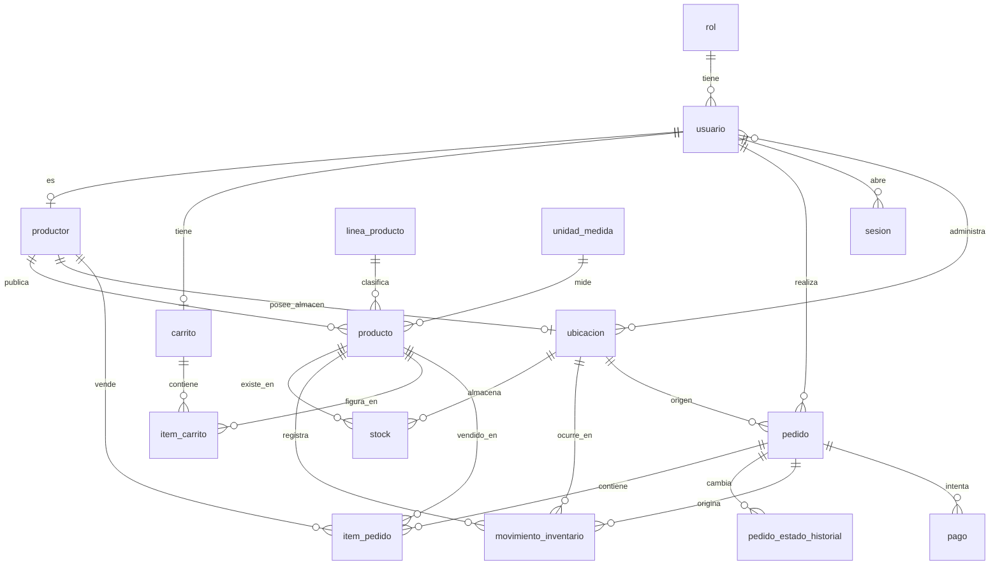
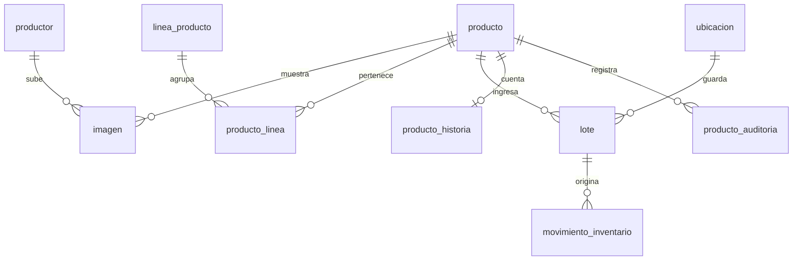
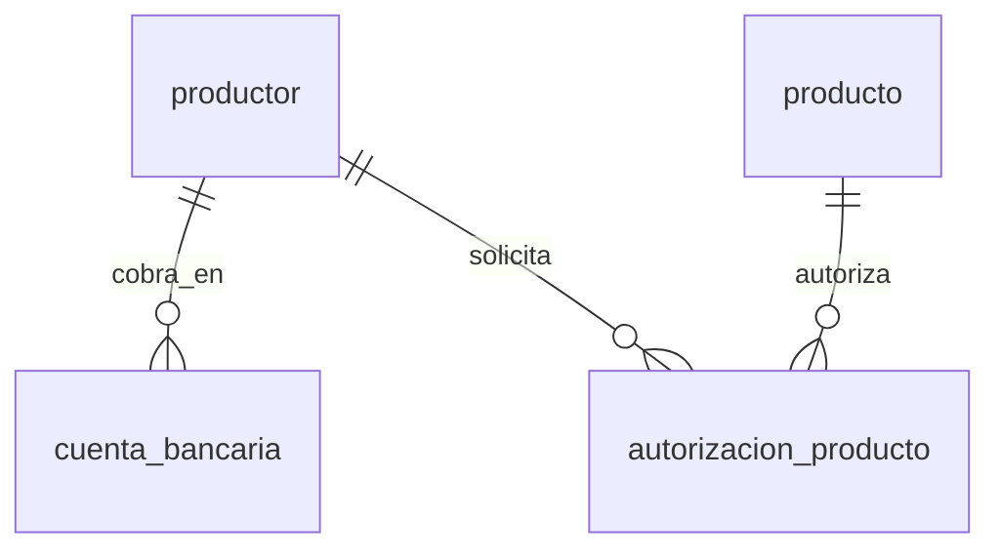
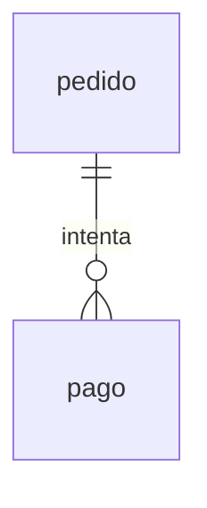

# Modelo de datos del ciclo de compra

Entregable de **CCPIP-19**. Alcance: lo que el primer MVP necesita para que un comprador
entre, encuentre un producto, lo compre y lo recoja en un punto de acopio.

Trece tablas. Probado contra PostgreSQL 17, la version de docker-compose: las cinco migraciones corren de cero sobre
una base vacia, las semillas se pueden volver a ejecutar sin duplicar, y las nueve
restricciones de los requisitos no funcionales bloquean lo que deben bloquear.

## Diagrama entidad relacion



La relacion central es **productor, producto y stock por ubicacion**. El lote entra en
Sprint 1 con CCPIP-41 y se cuelga de producto sin tocar pedido ni carrito, que es uno
de los criterios de aceptacion de esta historia.

## Diccionario de datos

### rol
Catalogo cerrado de los seis roles. No se crea ni se edita desde la aplicacion en
Sprint 0, eso es CCPIP-28.

| Columna | Tipo | Nulo | Nota |
|---|---|---|---|
| id | smallint | no | Llave primaria, valor fijo del 1 al 6 |
| codigo | varchar(40) | no | Unico. CONSUMIDOR, PRODUCTOR, ADMIN_PUNTO, SUB_ADMIN, SUPER_ADMIN, DISTRIBUIDOR |
| nombre | varchar(80) | no | Nombre para mostrar |

### usuario
| Columna | Tipo | Nulo | Nota |
|---|---|---|---|
| id | bigserial | no | |
| correo | varchar(255) | no | Unico, e indexado en minusculas. RNF-40 |
| contrasena_hash | varchar(255) | no | Solo el hash BCrypt. RNF-01 |
| nombre | varchar(160) | no | |
| rol_id | smallint | no | Referencia a rol |
| activo | boolean | no | Una cuenta se desactiva, no se borra. RNF-18 |
| intentos_fallidos | smallint | no | Contador para el bloqueo temporal |
| bloqueado_hasta | timestamptz | si | Nulo significa no bloqueado. RNF-02 |

### sesion
Sesion con token opaco aleatorio, entregado en cookie HttpOnly y guardado en el servidor.
Cerrar sesion borra la fila, y eso invalida el acceso de inmediato como exige RNF-03
(CCPIP-266). La sesion expira tras un plazo sin actividad configurable,
`ccpip.auth.session-timeout` (variable `CCPIP_AUTH_SESSION_TIMEOUT`; 30 minutos por defecto, 2
en el stack de e2e). El carrito vive en `carrito` e `item_carrito`, ligado al usuario y no a la
sesion: expirar o cerrar sesion no lo borra, y al volver a ingresar sigue igual (CCPIP-267).
Reemplaza a la tabla token_revocado que venia de usar JWT: con JWT habia que consultar
la lista de revocados en cada peticion de todos modos, y la expiracion por inactividad
obligaba a reemitir tokens. ADR-05 se actualiza a token opaco.

| Columna | Tipo | Nulo | Nota |
|---|---|---|---|
| token_hash | char(64) | no | SHA-256 del token, llave primaria. El token en claro nunca se guarda |
| usuario_id | bigint | no | Indexado, para cerrar todas las sesiones al bloquear a un usuario |
| creado_en | timestamptz | no | |
| ultimo_acceso | timestamptz | no | Indexado. Base de la expiracion por inactividad y de la purga |

### linea_producto, unidad_medida
Catalogos cerrados. RNF-32: el productor no crea unidades de medida, las solicita al
administrador, que es CCPIP-119 y CCPIP-137 en Sprint 1.

### productor
| Columna | Tipo | Nulo | Nota |
|---|---|---|---|
| id | bigserial | no | |
| usuario_id | bigint | no | Unico. Un usuario de rol PRODUCTOR es un productor |
| comunidad | varchar(160) | no | Nombre de la comunidad productora |
| region | varchar(80) | no | Indexado, para el filtro de CCPIP-165 |
| historia | text | si | Historia de la comunidad, distinta de la del producto |
| origen_verificado | boolean | no | CCPIP-38. Entra sembrado, no hay flujo de postulacion |
| activo | boolean | no | |

### producto
| Columna | Tipo | Nulo | Nota |
|---|---|---|---|
| id | bigserial | no | |
| productor_id | bigint | no | |
| nombre | varchar(200) | no | Indexado con lower(inmutable_unaccent(nombre)) para RNF-22 |
| descripcion | text | si | |
| historia_origen | text | si | CCPIP-152. El diferenciador de la plataforma |
| linea_id | smallint | no | |
| unidad_medida_id | smallint | no | |
| precio | numeric(10,2) | no | Mayor que cero. En soles, RNF-43 |
| es_materia_prima | boolean | no | Producto terminado o materia prima |
| estado | varchar(20) | no | BORRADOR, PUBLICADO o RETIRADO. RNF-17 |

### ubicacion
Una sola tabla para punto de acopio y almacen de productor, porque ambos siguen las
mismas reglas de movimiento y merma, que es lo que pide CCPIP-136. Separarlos en dos
tablas obligaria a duplicar stock y movimiento_inventario.

| Columna | Tipo | Nulo | Nota |
|---|---|---|---|
| id | bigserial | no | |
| tipo | varchar(20) | no | PUNTO_ACOPIO o ALMACEN_PRODUCTOR |
| nombre | varchar(160) | no | Unico entre los puntos de acopio |
| productor_id | bigint | si | Obligatorio si es almacen, prohibido si es punto de acopio |
| departamento, provincia, distrito | varchar | depto no | Division politica. Sin coordenadas: RNF-31 |

### usuario_ubicacion
Que punto administra cada usuario. Es lo que sostiene el aislamiento de RNF-05, que se
aplica filtrando en la consulta al servidor y no ocultando datos en la pantalla.

### stock
**Es una tabla, no una vista.** Se actualiza en la misma transaccion que cada
movimiento. Decidido en ADR-10 y es la decision mas facil de malinterpretar de todo el
modelo: si fuera una vista que suma movimientos, se perderia la restriccion de cantidad
no negativa y cada lectura del catalogo seria una agregacion.

| Columna | Tipo | Nulo | Nota |
|---|---|---|---|
| producto_id, ubicacion_id | bigint | no | Llave primaria compuesta |
| cantidad | numeric(12,3) | no | CHECK cantidad >= 0. RNF-09 |

El **stock virtual unico** que ve el consumidor es la suma de las filas de un producto
en todas sus ubicaciones. No se guarda en ninguna parte, se calcula al consultar:

```sql
SELECT sum(cantidad) FROM stock WHERE producto_id = :id;
```

### movimiento_inventario
Tabla de solo insercion. Dos disparadores impiden UPDATE y DELETE, porque una regla que
solo vive en el codigo de la aplicacion se salta desde cualquier cliente SQL. RNF-15 y
RNF-16: una correccion se hace con un movimiento de tipo AJUSTE que conserva el original.

| Columna | Tipo | Nulo | Nota |
|---|---|---|---|
| id | bigserial | no | |
| producto_id, ubicacion_id | bigint | no | |
| tipo | varchar(20) | no | ENTRADA, SALIDA_VENTA, TRANSFERENCIA_ENTRADA, TRANSFERENCIA_SALIDA, AJUSTE |
| cantidad | numeric(12,3) | no | Siempre positiva. El signo lo da el tipo |
| pedido_id | bigint | si | Cuando el movimiento viene de una venta |
| usuario_id | bigint | si | Quien lo registro |

### carrito, item_carrito
El carrito se persiste en base de datos, no en el navegador. Era el punto abierto numero
uno del informe de arquitectura: el modulo lo mencionaba y el modelo no lo tenia.

RNF-35: estar en el carrito **no reserva ni descuenta** stock. Un producto aparece una
sola vez por carrito, agregarlo de nuevo suma cantidad.

### pedido, item_pedido, pedido_estado_historial
| Columna | Tipo | Nulo | Nota |
|---|---|---|---|
| numero | varchar(20) | no | Unico, el que ve el comprador |
| modalidad | varchar(20) | no | RECOJO o ENVIO. En Sprint 0 solo RECOJO |
| ubicacion_origen_id | bigint | no | Punto donde recoge o desde donde se despacha |
| estado | varchar(30) | no | CONFIRMADO, EN_PREPARACION, LISTO_PARA_RECOJO, ENTREGADO, CANCELADO |
| total | numeric(12,2) | no | En soles. Sin columna de divisa, RNF-43 |

**item_pedido.precio_unitario es copia del precio al confirmar.** RNF-13: un cambio
posterior en producto.precio no altera un pedido ya confirmado. Para mostrar un pedido
pasado nunca se lee el precio vigente.

**item_pedido.productor_id tambien se copia**, para que el aislamiento de RNF-05 no
dependa de seguir la cadena hasta producto, que puede haber cambiado de estado.

## Como se cumple RNF-10, que es el requisito mas delicado

"El descuento de existencias al confirmar un pedido resiste pedidos simultaneos sin
duplicar ni perder unidades."

No se resuelve con bloqueos ni con reintentos. Se resuelve con un UPDATE condicionado,
que es atomico en PostgreSQL:

```sql
UPDATE stock
   SET cantidad = cantidad - :pedida
 WHERE producto_id = :producto
   AND ubicacion_id = :ubicacion
   AND cantidad >= :pedida;
```

Si devuelve cero filas afectadas, no habia suficiente y el pedido se rechaza. Dos
pedidos simultaneos no pueden llevarse la misma unidad porque el segundo encuentra la
cantidad ya decrementada. Probado: con 3 unidades, un pedido de 2 pasa y el siguiente de
2 se rechaza, quedando 1 y nunca un negativo.

El movimiento de inventario se escribe **en la misma transaccion** que ese UPDATE. Si se
escriben por separado, un fallo entre ambos deja el stock sin explicacion.

## Tienda, publicacion, lotes e imagenes (Sprint 1)

Migraciones `V202610041200` a `V202610041204`. Agregan lo que necesita el flujo del prototipo:
la comunidad arma su tienda, publica productos con fotos e historia, registra lotes, y el
comprador ve solo lo que de verdad se puede vender.



### productor (columnas de tienda, CCPIP-30, 56, 153, 154)
La tienda vive en la fila del productor: hay exactamente una por productor. `nombre_tienda`,
`descripcion_corta`, `cita`, `pueblo`, `localidad`, `socios`, `verificado_en`,
`tienda_publicada` y `tienda_publicada_en`. Una tienda publicada siempre tiene nombre (CHECK).
Solo las tiendas publicadas aparecen en `/api/tiendas` y sus productos en el catalogo.

### producto (columnas nuevas, CCPIP-40, 45, 47, 132, 143)
Un producto nace como borrador desde PW-04, por eso `linea_id`, `unidad_medida_id` y `precio`
pasan a aceptar nulos; publicar los exige (servidor). Nuevas: `contenido` ("250 ml"),
`modalidad` (MINORISTA, MAYORISTA, AMBAS), `precio_mayorista` (menor que el minorista, CHECK),
`cantidad_minima_mayorista` (2 o mas), `destacado_tienda`, `descripcion_propuesta` y
`descripcion_asistida` (IA, RNF-29), `publicado_en`, `creado_por` y `actualizado_por`.
No hay columna de descuento (CCPIP-87) ni forma de borrar un producto (RNF-17): se despublica.

### producto_linea (CCPIP-45)
Un producto puede estar en varias lineas. `producto.linea_id` queda como la principal, la que
muestra la tarjeta. `linea_producto` gana `requiere_vencimiento` (una artesania no vence),
`unidad_sugerida_id` y `orden`.

### lote (CCPIP-41)
| Columna | Tipo | Nulo | Nota |
|---|---|---|---|
| producto_id, ubicacion_id | bigint | no | Ubicacion: almacen del productor o punto de acopio |
| codigo | varchar(40) | no | Unico por producto. Interno: nunca se muestra al comprador |
| cantidad_inicial, cantidad_actual | numeric(12,3) | no | 0 ≤ actual ≤ inicial (RNF-09) |
| fecha_produccion, fecha_vencimiento | date | si | Vencimiento posterior a la produccion; no anterior a hoy (servidor) |

Registrar un lote escribe el lote, su movimiento `ENTRADA` (`movimiento_inventario.lote_id`) y
suma al `stock` en una sola transaccion (ADR-10). **Lo que el comprador ve como disponible es
la suma de los lotes no vencidos en puntos de acopio**; lo que esta en el almacen del productor
se vende recien cuando se transfiera.

### imagen (CCPIP-30, 44)
Referencia a un objeto del bucket S3 (`clave` y `clave_miniatura`), con `tipo` PORTADA,
GALERIA o PRODUCTO, `categoria` de galeria, dimensiones y `principal`. Una sola portada por
tienda y una sola principal por producto (indices unicos parciales). Se sirve por
`/api/imagenes/{id}`, nunca con la URL del bucket, que es privado.

### producto_historia (CCPIP-48, 49)
Las cuatro respuestas del productor (`quienes`, `como`, `significado`, `cuidado`), el texto
que propuso la IA (`texto_propuesto`) y el aprobado (`texto_final`), con `asistida`,
`proveedor_ia`, `aprobada_en` y `aprobada_por`. La ficha solo muestra historias aprobadas.

### producto_auditoria (CCPIP-47)
Quien cambio que y cuando: `accion` (CREAR, EDITAR, PUBLICAR, RETIRAR, REPUBLICAR, HISTORIA,
LOTE, IMAGEN) y `cambios` en jsonb con el antes y el despues. Solo insercion: un trigger
rechaza UPDATE y DELETE, igual que en `movimiento_inventario`.

## Cuenta bancaria y autorizacion para vender (CCPIP-269)

Migracion `V202610121000`. RF-142: solo se compra lo autorizado a un productor con cuenta
bancaria activa. Entra solo lo que esa regla necesita; el registro de la cuenta (CCPIP-32) y el
flujo de autorizacion con evidencias (CCPIP-359) agregan lo suyo con sus historias.



### cuenta_bancaria
`productor_id`, `banco`, `titular`, `numero_cuenta`, `cci` y `estado` (ACTIVA, DESACTIVADA).
Como maximo una ACTIVA por productor (indice unico parcial); las desactivadas se conservan.
No vence (CCPIP-129).

### autorizacion_producto
`productor_id`, `producto_id`, `estado` (SOLICITADA, APROBADA, RECHAZADA, REVOCADA), `motivo`,
`decidido_por`, `decidido_en` y `vigente_hasta` (nula si no vence). Unica por productor y
producto. El diccionario la liga a `producto_maestro`, que aun no existe: por ahora apunta a
`producto`. La migracion deja APROBADA lo que ya se vendia.

**Una oferta es comprable** si su productor tiene una cuenta ACTIVA y una autorizacion APROBADA
para ese producto con `vigente_hasta` nula o de hoy en adelante (hora de Lima). Si no, sigue
visible en el catalogo, pero en "Venta pausada": la ficha lo dice con `comprable: false` y el
carrito marca el item `VENTA_PAUSADA` sin sumarlo al total.

## Descuento de existencias por venta (CCPIP-158)

Migracion `V202610121700`. Al confirmar una compra, cada linea de pedido sale de los lotes
vigentes del punto de recojo, primero el que vence antes, con un movimiento `SALIDA_VENTA` por
lote. Lote, stock y movimiento cambian en la misma transaccion que el pedido (RNF-10, ADR-10).

- `movimiento_inventario.item_pedido_id`: la linea de pedido que origina la venta.
- CHECK: una `SALIDA_VENTA` siempre tiene `pedido_id`, `item_pedido_id` y `lote_id`.
- Indice unico parcial `(item_pedido_id, lote_id)` para `SALIDA_VENTA`: aunque la confirmacion
  se reintente, una linea no descuenta dos veces el mismo lote.

El administrador del punto los consulta en `/api/acopio/movimientos` (Figma A-03), solo de los
puntos que tiene en `usuario_ubicacion` y sin los datos del comprador (RNF-05).

**Lotes asignados (CCPIP-74, RNF-14).** Un lote vencido nunca se asigna: solo cuentan los que
vencen hoy o despues (hora de Lima), el que vence antes sale primero y lo que no vence, como una
artesania, al final. Cada linea conserva de que lotes salio por sus movimientos `SALIDA_VENTA`
(`item_pedido_id` + `lote_id`), y `/api/acopio/pedidos` los muestra en cada linea del pedido.

## Recojo del pedido (CCPIP-71)

Migracion `V202610131800`. El administrador del punto entrega un pedido `LISTO_PARA_RECOJO` al
comprador o a la persona autorizada y lo deja `ENTREGADO`. Cierra la venta **sin tocar el
inventario**: el descuento ya ocurrio al confirmar (CCPIP-158) y no se repite.

- `pedido.persona_autorizada` y `pedido.celular_contacto`: los registra la confirmacion de la compra
  (CCPIP-157) y el recojo los valida. Nulos: recoge el comprador, o el pedido aun no tiene contacto.
- `pedido.recogido_por` y `pedido.recogido_celular`: constancia de quien se lo llevo y con que
  celular. Van juntos (CHECK) y solo con estado `ENTREGADO`. El responsable del punto y la fecha
  quedan en `pedido_estado_historial`.
- Quien recoge debe ser el comprador o la persona autorizada, sin distinguir mayusculas, tildes ni
  espacios; el celular se normaliza a 9 digitos (admite `+51`, espacios y guiones) y debe coincidir
  con el registrado si lo hay. El rechazo no revela cual era el dato correcto (RNF-05).

## Pago y su estado (CCPIP-62, CCPIP-163, CCPIP-157)

Migracion `V202610132100__pago.sql`. El pedido existe **antes** de pagarse, en
`PENDIENTE_PAGO`, porque CCPIP-163 consulta "los intentos de pago de su pedido". Solo pasa a
`CONFIRMADO` cuando un intento sale `APROBADO`, y recien ahi se descuenta el stock. Un rechazo
no confirma ni descuenta (CCPIP-62).



### pedido (cambios)
- `estado` admite `PENDIENTE_PAGO`. Un pedido sin pagar puede pasar a `CANCELADO`.
- `confirmado_en` admite nulos: se llena al confirmar. `pedido_confirmacion_coherente` exige que
  sea nulo en `PENDIENTE_PAGO` y no nulo desde `CONFIRMADO`.
- Nueva columna `creado_en`, porque antes el pedido nacia confirmado.

### pago
Un intento por fila. Un reintento es una fila nueva, asi cada intento queda registrado.

| Columna | Tipo | Nulo | Nota |
|---|---|---|---|
| id | bigserial | no | |
| pedido_id | bigint | no | |
| clave_idempotencia | uuid | no | Unica. La genera el frontend por intento: el mismo intento enviado dos veces no cobra dos veces |
| metodo | varchar(20) | no | Por ahora solo `TARJETA`. Un metodo local tipo Yape entra con CCPIP-183 |
| monto | numeric(12,2) | no | Mayor que cero, en soles (RNF-43), igual al total del pedido |
| estado | varchar(20) | no | `PENDIENTE`, `APROBADO`, `RECHAZADO`, `ERROR` o `ANULADO` |
| pasarela | varchar(40) | no | Por ejemplo `SIMULADA` o la de pruebas que se use |
| referencia_pasarela | varchar(100) | si | Identificador de la transaccion. Obligatoria si esta aprobado o anulado |
| marca_tarjeta | varchar(20) | si | `VISA`, `MASTERCARD`, `AMEX` o `DINERS`. Obligatoria con tarjeta |
| codigo_respuesta, mensaje_respuesta | varchar | si | Motivo del rechazo o error, para el comprador |
| creado_en, resuelto_en, anulado_en | timestamptz | | `resuelto_en` al salir de PENDIENTE; `anulado_en` solo si se anula |

**No se guarda la tarjeta**: ni numero, ni vencimiento, ni CVV. Vive en memoria mientras se
valida (Luhn, marca, CVV de 3 o 4 digitos) y se envia a la pasarela. Lo ideal es que la pasarela
tokenice desde el frontend y la tarjeta ni pase por el backend.

**Reglas en la base**, como en `movimiento_inventario`, porque una regla solo en el codigo se
salta desde cualquier cliente SQL:

- Un solo pago `APROBADO` por pedido y un solo `PENDIENTE` a la vez (indices unicos parciales).
- Solo se paga un pedido en `PENDIENTE_PAGO`, y por su total exacto (disparador al insertar).
- El estado solo avanza `PENDIENTE` -> `APROBADO` | `RECHAZADO` | `ERROR`, y `APROBADO` ->
  `ANULADO`. Un pago no se borra ni cambia de pedido, monto o clave (disparador).

**Flujo esperado:**

1. CCPIP-157 revalida precio, oferta, stock y cuenta bancaria y crea el pedido en
   `PENDIENTE_PAGO`, con el precio copiado en cada linea. No toca el stock.
2. CCPIP-62 registra el intento en `PENDIENTE`, llama a la pasarela y guarda el resultado.
3. Si sale `APROBADO`, en una sola transaccion: UPDATE condicionado del stock (RNF-10),
   movimientos `SALIDA_VENTA`, pedido `CONFIRMADO` y su historial. Si el stock ya no alcanza
   (otro comprador se lo llevo mientras se pagaba), el pedido pasa a `CANCELADO` y el pago a
   `ANULADO`, devolviendo el cobro en la pasarela.
4. Si sale `RECHAZADO` o `ERROR`, el pedido sigue en `PENDIENTE_PAGO` y se puede reintentar.

Queda fuera: vencer los pedidos que nunca se pagan (tarea programada que los pase a
`CANCELADO`), comision y liquidacion (CCPIP-90, CCPIP-91) y metodos locales (CCPIP-183).
Lo verifica `PagoModeloTest`.

## Fuera de este modelo

Se modela cuando llegue su sprint, y el modelo actual admite agregarlo sin rehacer nada:

- Cobertura del punto de acopio y division politica del Peru, Sprint 1, CCPIP-149
- Comision y liquidacion, Sprint 1, CCPIP-90 y CCPIP-91
- Merma y sus causas, Sprint 2
- Valoraciones y denuncias, Sprint 2
- Traducciones del contenido, Sprint 3, CCPIP-170
- Fidelizacion, Sprint 3, CCPIP-86

## Convencion de nombres de las migraciones

Las versiones son **fecha y hora de creacion**, en formato `YYYYMMDDHHMM`, no numeros
secuenciales:

```
V202610020032__usuario_rol.sql
V202610051432__agregar_lote.sql
```

El motivo es concreto. Con numeros secuenciales, dos personas que salen de main crean
las dos `V6__`, y al fusionar el segundo PR hay dos V6. Flyway falla con version
duplicada, el segundo tiene que renombrar, y quien ya corrio su V6 local queda con el
historial desalineado. Con diez integrantes y varios PR al dia eso pasa cada semana.

Con fecha y hora no colisionan, porque nadie crea el archivo en el mismo minuto, y si
pasara se nota de inmediato en el PR. El orden sigue siendo determinista: Flyway compara
las versiones numericamente.

Las repetibles usan el prefijo `R__`, que en Flyway significa repetible: se aplican
despues de todas las migraciones versionadas y se vuelven a aplicar cuando cambia su
contenido. Eso es exactamente lo que queremos para datos sembrados idempotentes.

- `db/migration/R__01_catalogos_base.sql`: roles, catalogos y puntos de acopio. Corre en
  todos los ambientes, porque sin ellos la aplicacion no funciona.
- `db/seed/R__02_cuentas_productores_productos.sql`: una cuenta de demostracion por rol
  (clave publica `Demo1234!`, ver docs/devsecops.md), productores y productos. Corre en
  todos los ambientes porque las revisiones de sprint y la prueba de humo del despliegue
  usan esas cuentas. Para un ambiente sin demo basta quitar `db/seed` de
  `spring.flyway.locations`.
  Las existencias iniciales entran como lote, movimiento de ENTRADA ligado a ese lote y
  stock, en un solo comando (CCPIP-361). La autorizacion, la historia aprobada y las
  existencias solo se siembran para los diez productos de la semilla: un producto creado
  desde la plataforma no las recibe aunque la semilla vuelva a correr. Lo verifica
  `SemillasTest`. El
numero en `R__01_` y `R__02_` fija el orden, porque las repetibles corren en orden
alfabetico y la segunda depende de la primera.

### Lo que la fecha y hora no resuelve

Dos personas pueden agregar en paralelo una columna a la misma tabla. Los archivos no
colisionan, pero la segunda migracion puede asumir un estado que la primera no dejo.
Eso no lo arregla ninguna herramienta, se arregla en la revision del PR y corriendo
`docker compose down -v` despues de traer main, que reconstruye desde cero y lo revienta
de inmediato si hay conflicto.

## Pendiente de aprobacion del equipo

El criterio de aceptacion de CCPIP-19 dice que ninguna migracion se escribe antes de que
este modelo este aprobado. Las migraciones ya estan escritas y probadas, asi que lo que
falta es que el equipo lo revise. Si cambia algo, se corrige antes de que alguien mas
corra V1 a V5, porque despues ya no se puede editar un archivo aplicado.
